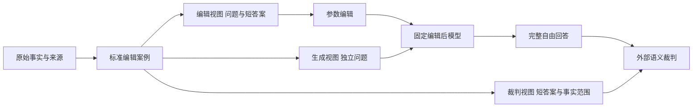

# 扩散知识编辑数据集构建

整理日期：2026 年 10 月 15 日。适用范围：本项目掩码扩散语言模型的事实知识编辑。本文汇总现有数据与构建程序，并规定下一版数据的构建和验收要求；新增结构均为设计规格，尚未写入现有数据文件。

数据集服务于方法研究：给编辑器提供主体、关系和短新答案，检验一次参数修改能否让模型在多次去噪后正确调用新知识。最终评价使用完整自由回答及其事实语义，不要求提供完整长答案参考文本。相关规格见 [扩散知识编辑模型](C:/Users/admin/Documents/MDLM/技术文档/02_扩散知识编辑模型.md)和[外部大模型评测框架](C:/Users/admin/Documents/MDLM/技术文档/03_外部大模型评测框架.md)。

## 1 任务定义与数据边界

一条编辑案例由目标事实及与之关联的编辑问题、独立测试问题、保持问题构成。目标事实至少明确“谁、什么关系、新对象是什么”；存在时间、范围或关系多值性时，必须一并记录。

三类输入必须分开：

| 使用方 | 可接收的信息 | 用途 |
| --- | --- | --- |
| 编辑器 | 编辑问题、主体和关系、短新答案、允许的编辑训练数据和保持训练数据 | 构造目标或梯度，计算参数更新 |
| 被编辑模型的正式生成器 | 独立问题、固定生成配置、随机种子 | 自由去噪并生成回答 |
| 外部裁判 | 当前问题、相应短答案、目标命题、范围限定、模型完整回答 | 判断回答的事实语义 |

正式生成器不接收新答案、答案别名、参考回答或人工指定的正确去噪路径。编辑阶段可以依据短答案长度设置受控训练窗口；最终自由回答窗口由统一实验配置决定，不逐例按短答案长度缩短，也不预设答案出现位置。



本阶段优先构建反事实替换、问答式单跳编辑和有明确依赖链的多跳编辑。真实世界更新、新知识插入、遗忘与拒答可独立扩展，不能与精确写入新事实直接混算。

## 2 现有数据资产

以下数量来自本地文件及其统计文件核对，不代表来源数据集的完整官方规模。

| 数据 | 本地记录数 | 适用任务 | 主要注意事项 |
| --- | ---: | --- | --- |
| CounterFact | 7,510 | 单跳反事实替换、表达泛化、邻域保持 | 原始提示组不等于逐条核验过的问答标签 |
| ZsRE MEND eval | 19,086 | 问答式编辑、问题改写、无关问答保持 | `pred` 是已有预测字段，不能直接认定为事实真值 |
| MQuAKE | 3,000 | 多跳依赖与编辑后传播 | 一条源案例可能要求同时修改多个事实 |
| Pilot v0.1 | 50 | 早期结构与接口检查 | CounterFact 30、ZsRE 10、MQuAKE 10 |
| Length Pilot v0.2 | 100 | 槽长与数据流检查 | CounterFact 50、ZsRE 30、MQuAKE 20 |

原始文件位于[数据目录](C:/Users/admin/Documents/MDLM/项目代码/data)。两版 pilot 的 JSON 数组与 JSONL 记录一致。v0.2 槽长 16、32、64、128、256 分别有 50、15、15、15、5 条；所有新对象在现有正则估计下均属于 1 至 8 token 桶。

v0.2 还包含：

| 内容 | 数量 |
| --- | ---: |
| 直接编辑提示 | 100 |
| paraphrase 提示 | 190 |
| cloze 提示 | 200 |
| free_form_qa 提示 | 90 |
| portability 提示 | 90 |
| 全 mask 探针 | 100 |
| 旧答案部分可见探针 | 100 |
| 新答案部分可见探针 | 62 |
| 同主体其他关系保持问题 | 0 |
| 同关系保持问题 | 200 |
| 语义邻域保持问题 | 150 |
| 无关保持问题 | 30 |

这些数量描述构造产物，不能直接解释为有效、独立、标签正确的评测问题数。统计依据见 [v0.2 统计文件](C:/Users/admin/Documents/MDLM/项目代码/data/mdlm_length_pilot_v0.2/mdlm_editbench_length_pilot_v0.2.stats.json)。

项目还保存 TOFU、RWKU、MUSE、WMDP 等第三方数据，定位为遗忘和攻击鲁棒性扩展。其文本、拒答目标和任务定义与本项目短答案事实替换不同，分别记录结果。

## 3 现有构建流程及需要修正的问题

两个构建器分别是 [v0.1 构建器](C:/Users/admin/Documents/MDLM/项目代码/tools/data_building/build_mdlm_pilot.py)和[v0.2 构建器](C:/Users/admin/Documents/MDLM/项目代码/tools/data_building/build_mdlm_length_pilot.py)。它们读取三份源文件，转换事实、提示、长度、轨迹探针与局部性字段，再按固定随机策略导出。

### 3.1 CounterFact 提示的关系语义需逐条核验

现有构建器将部分 `generation_prompts` 统一标为新对象，将部分 `attribute_prompts` 统一标为语义邻域保持问题。源提示可能涉及不同关系；例如出生地问题和母语问题不能共享同一个新对象标签。

下一版应逐条核验提示对应的主体、关系和答案。缺乏可验证标签的提示先保留在候选池，不能仅依据所属数组给出金标准答案。CounterFact 原始邻域与属性设计可以提供线索，但不足以自动证明每个重构标签正确。

### 3.2 ZsRE 原预测与旧事实分开保存

现有程序优先用 `pred` 填充 `old_object`，并把 `answers` 混入旧对象别名。二者可能不一致；本地首条源记录就存在这种情况。

下一版区分 `source_prediction`、经过核验的旧答案集合和本次待编辑模型的编辑前输出。不同大学、城市或机构不能因为出现在同一记录中就互认为别名。无法核验旧事实的案例仍可用于限定的新目标写入实验，但不能用于“原模型旧知识已被纠正”的强结论。

### 3.3 MQuAKE 编辑集合与传播答案必须对应

源数据中，1、2、3、4 条 `requested_rewrite` 的案例分别有 1,093、1,067、572、268 条。现有两个构建器只取第一个 rewrite，却保留源数据的 `new_answer` 和多跳问题。v0.2 的 20 条 MQuAKE 案例中，有 10 条源案例含多个 rewrite。

这不能直接作为完成全部必要修改后的传播实验。下一版提供两个明确子集：

1. **单编辑依赖子集**：确认最终答案仅依赖被实际修改的一个事实；否则不纳入该子集。
2. **联合多编辑子集**：保存完整编辑请求集合、依赖图和联合答案，编辑器实际应用全部必要修改。

多跳问题统一放入 `portability`，不要同时计入普通改写、自由问答和传播三个独立成绩。答案别名按当前问题所问对象核验，不能假定 `new_single_hops[0]` 总与第一个 rewrite 正确对应。

### 3.4 泛化分类与训练用途标记需统一

v0.2 有 30 条 ZsRE 案例把与编辑问题相同的文本同时放入 `free_form_qa`；还把同一个 rephrase 放入 paraphrase 与 portability。前者不能算独立泛化，后者不具备多跳传播含义。

构建器写入 `use_for_edit`，当前评测器读取 `used_for_edit`。下一版统一使用 `used_for_edit`，迁移时显式转换历史字段。当前评测器会排除与编辑文本规范化后相同的泛化提示，但不同文本只要参与过训练，也必须标记，不能仅靠去重排除。

### 3.5 槽长和探针不等于真实分词结果

当前 `heuristic_regex_v0` 不是任何目标模型的 tokenizer。将一个字符串 `[MASK]` 重复 64 次，也不自动保证实际输入中恰好有 64 个模型 mask token。

历史 `mask_pattern` 是 0/1 可见性向量；严格固定探针接口把相应字段解释为待预测位置索引，并要求 `fixed_state`、`evaluation_positions` 等证据。必须先进行显式格式转换，并核对真实 token IDs，不能直接复用数组。

### 3.6 历史校验通过的范围有限

[已有校验报告](C:/Users/admin/Documents/MDLM/项目代码/data/mdlm_length_pilot_v0.2/validation_report.json)记录 2 个 medium 和 1 个 low 问题，未报告 critical/high；检查重点是字段、启发式长度和 mask 数量，不覆盖上述事实映射、编辑依赖和裁判可靠性问题。

在当前研究目标下，短答案配合长生成窗口是预期设置，不要求为消除旧报告的“长答案覆盖不足”而补充完整长答案监督。同主体其他关系保持问题缺失则仍是必须补齐的评价缺口。

## 4 下一版统一案例结构

下面是待实现的结构示例，实体与城市均为虚构，`schema_version` 明确标为提案。保留现有加载器识别的 `fact_core`、`prompts` 和 `answer`；其中 `answer` 的含义是短答案参考，不能按旧代码注释理解为必须提供完整长句。

```json
{
  "case_id": "constructed_birth_city_0001",
  "schema_version": "0.3-proposal",
  "split": "gold",
  "edit_direction": "counterfactual",
  "language": "zh",
  "fact_core": {
    "subject": "林舟",
    "relation": "birth_city",
    "relation_text": "出生城市",
    "old_object": "青榆市",
    "new_object": "海岚市",
    "new_object_aliases": ["海岚市"],
    "edit_type": "counterfactual",
    "domain": "constructed"
  },
  "truth_scope": {
    "public_fact": false,
    "dataset_internal": true,
    "constructed_fact": true,
    "counterfactual": true,
    "privacy_sensitive": false
  },
  "source": {
    "source_dataset": "constructed_gold",
    "source_id": "0001",
    "source_version": "v1",
    "annotation_method": "human_verified"
  },
  "prompts": {
    "edit": [
      {
        "probe_id": "birth_edit",
        "prompt": "林舟的出生城市是哪座？",
        "answer": "海岚市",
        "used_for_edit": true
      }
    ],
    "paraphrase": [
      {
        "probe_id": "birth_test",
        "prompt": "请用完整句子说明林舟出生在哪座城市。",
        "answer": "海岚市",
        "answer_aliases": ["海岚市"],
        "used_for_edit": false,
        "reference_type": "short_answer",
        "target_proposition": "林舟的出生城市是海岚市。"
      }
    ],
    "cloze": [],
    "free_form_qa": [],
    "portability": []
  },
  "generation_profile": {
    "mode": "free_response",
    "window_policy_id": "free_window64_v1"
  },
  "trajectory_probes": [],
  "kg_consequence": {
    "expected_ripples": [],
    "preserve_edges": [],
    "forbidden_leakage": []
  },
  "locality": {
    "same_subject": [],
    "same_relation": [],
    "semantic_neighbor": [],
    "unrelated": []
  },
  "quality_control": {"status": "example_only"},
  "metadata": {"note": "结构示例，不是可直接发布的完整样本"}
}
```

正式发布还须补齐真实 tokenizer 的 `length_profile`、实际探针、来源许可、质量检查及必要的保持问题。空数组在示例中用于说明缺失，不表示正式 gold 样本已达标。上例的 `gold` 划分及新增字段需要新版 schema 显式支持，不能假称旧校验器已经支持。

每个评价提示都应有自己的短答案与命题。传播问题的答案可能与 `new_object` 不同；保持问题更不能继承待编辑事实的新对象。缺少提示级真值时标记不可评价，不默认回退到 `new_object`。

## 5 构建流水线

| 阶段 | 处理内容 | 输出与验收条件 |
| --- | --- | --- |
| 原始接入 | 保存输入快照、版本、文件摘要、许可和源 ID | 能按源 ID 回查；原文件不被覆盖 |
| 事实规范化 | 消歧主体与关系，核验旧新对象、别名、时间和多值性 | 非空目标；旧新对象及别名无冲突 |
| 依赖审核 | 还原 MQuAKE 编辑集合与推理链，区分应变后果和应保事实 | 每个传播问题记录必要编辑及短答案来源 |
| 提示整理 | 保留可信原提示，补充独立改写、自由问答与同主体保持题 | 问题关系正确；训练与测试提示无重叠 |
| 模型分词 | 用精确 tokenizer 和实际输入模板对齐答案、主体与 mask | 按模型保存 revision、token IDs、位置和长度 |
| 窗口配置 | 分开记录训练答案窗口与正式自由生成预算 | 正式预算不依据逐例标准答案长度调整 |
| 探针构建 | 分开构造自然轨迹、固定部分状态和带答案片段的诊断 | 记录构造来源、位置语义和是否暴露目标 |
| 编辑前检查 | 相同配置下运行原模型，记录旧答案、新答案和其他输出 | 保留全部案例及筛选原因；不声称证明模型绝对未知 |
| 划分与人工审核 | 按实体和源链分组，隔离开发用途和独立测试用途 | 同一事实的改写、槽长变体和依赖链不跨集合泄漏 |
| 导出与冻结 | JSONL、构建清单、统计、质量报告与分割清单 | 数据版本及摘要可追溯；语义变化升级版本 |

### 5.1 真实 tokenizer 与长度档案

每个模型分别保存 tokenizer 来源及 revision、chat template、mask ID、主体 token 范围、短答案 token IDs、训练监督位置、正式生成窗口、有效上下文长度和终止协议。

答案须在实际模板上下文中分词核验，处理前导空格、特殊标记和 logit 位置偏移。Dream 等模型的预测位置对齐应由后端声明；不能按 LLaDA 规则统一硬编码。

旧数据中的 64 可保留为首个自由窗口候选，16、32、128 可作敏感性配置，256 可作压力配置。这些是待开发集确定的预算，不是已验证最佳值。各模型还需满足自己的分块与步数约束。窗口长度、最终有效文本长度、去噪步数、实际网络调用数分别记录。

### 5.2 三类状态的用途

| 状态类型 | 是否含人工答案片段 | 是否可作主自由生成成绩 |
| --- | --- | --- |
| 模型自主采样的自然轨迹 | 不含 | 可以；保存完整生成结果和配置 |
| 固定 token/mask 状态 | 视构造方式而定 | 作为固定条件诊断，单独报告 |
| 新答案前后缀可见探针 | 含有 | 只作条件补全诊断 |

固定探针必须说明位置是全序列索引还是答案区域索引、0/1 的含义、待预测位置及可见 token。完全显示目标答案的探针不进入补全成功率。单调采样中已经固定错误 token 的状态可能无法补全完整目标，应保留冲突标签。

### 5.3 保持集与传播集

同主体其他关系、同关系其他主体、语义邻域、无关知识四类保持问题分别构建。每题均需独立真值。预期传播与保持集合不能在语义上相互冲突：依赖被修改事实的后果应变化，不能同时被要求保持原答案。

训练保持数据、构造统计量的数据、开发验收数据、最终保持测试数据要记录用途。独立测试题不得因为被用于保持优化而仍被称为未见问题。

### 5.4 数据切分与模型预检查

按主体实体分组，进一步约束源案例、MQuAKE 依赖链、模板及重复事实。按行随机切分不足以隔离同一事实。多个模型共享同一主测试集合；模型专属可编辑子集另行公布，避免逐模型过滤造成不可比。

编辑前分别记录目标新事实正确率、旧事实正确率和无法回答比例。真实更新与新增知识还需来源时间证据；仅凭有限提示未回答正确，不能证明模型训练语料中从未见过该事实。

## 6 质量门槛与规模路线

先从现有三源候选中制作 20 至 30 条 gold，用真实 tokenizer、人工真值和完整生成完成联调。gold 应覆盖真实多 token 对象、旧新对象重叠、同主体其他关系、反事实目标、多跳依赖与否定表达。随后修复并重建 50 至 100 条 pilot，再决定扩容。

发布前必须满足：

1. 数据可解析、ID 唯一、原始记录可追溯，短答案及别名通过审核。
2. 编辑集合与所有下游答案对应；不完整的多编辑案例不进入传播主结果。
3. 训练、开发、测试用途明确，重复提示及跨类别复用不增加独立样本权重。
4. 目标模型的分词与 mask 位置核验通过；启发式长度只保留为历史记录。
5. 同主体保持与预期传播均有实际可评价样本，缺失切片公开标注。
6. 自由生成输入不含目标答案，完整长句不作为必要监督。
7. 外部裁判校准通过后才发布语义成功率；未覆盖、失败和不确定记录保留。

gold 与 pilot 建议逐条人审。更大规模可以分层抽查，但必须公开抽查量、错误类别和修订版本。是否增加数据由覆盖缺口和方法实验需要决定，不以固定数量替代质量门槛。

## 7 与现有程序的衔接

| 位置 | 当前能力 | 下一版工作 |
| --- | --- | --- |
| 两个 pilot 构建器 | 三源映射、固定抽样、启发式长度、JSON/JSONL 导出 | 修复真值映射、MQuAKE 编辑集合、用途标记和类别 |
| 数据校验器 | 字段、槽长、0/1 掩码和覆盖警告 | 增加真实 token、依赖关系、提示泄漏、别名与来源审核 |
| `case_from_dict` | 兼容 `id/case_id`，生成评测对象 | 禁止评价真值缺失时默认继承新对象；提供分用途视图 |
| `GenerationRequest` | 同时携带问题与参考答案等元数据 | 在真实模型边界只传允许的推理输入 |
| 评测器 | 泛化文本去重、案例聚合、可选裁判接口 | 接入冻结的语义评价规则与缺测覆盖口径 |

当前校验入口的实际用法如下。它会向指定新目录写报告，仍只执行旧版检查；不会自动修复数据：

```powershell
python "C:/Users/admin/Documents/MDLM/项目代码/tools/data_building/validate_mdlm_dataset.py" "C:/Users/admin/Documents/MDLM/项目代码/data/mdlm_length_pilot_v0.2/mdlm_editbench_length_pilot_v0.2.jsonl" --output-dir "C:/Users/admin/Documents/MDLM/中间过程文件/实验输出/dataset_review_v03"
```

## 8 项目依据与版本关系

| 依据 | 本文采用的内容 |
| --- | --- |
| [研究长期上下文](C:/Users/admin/Documents/MDLM/RESEARCH_CONTEXT.md) | 方法研究目标；短答案内容编辑、自由长窗口、多次前向的边界 |
| [项目执行手册](C:/Users/admin/Documents/MDLM/MDLM_项目版.md) | 数据 schema、来源、构建阶段、局部性与指标定义 |
| [数据中文说明](C:/Users/admin/Documents/MDLM/项目代码/data/中文说明.md) | 历史数据字段和轨迹格式兼容条件 |
| [数据加载结构](C:/Users/admin/Documents/MDLM/项目代码/mdlm_eval/schema.py) | 当前字段的真实读取与默认行为 |
| [评测执行器](C:/Users/admin/Documents/MDLM/项目代码/mdlm_eval/evaluator.py) | 泛化排除与逐问题真值使用 |
| [9 月 23 日模型方案](C:/Users/admin/Documents/MDLM/output/pdf/研究方案汇编_20260923/03_模型方案文档.md) | 短窗口训练与长窗口迁移评价的区分 |

整理以项目研究文稿、三份方案汇编、后续框架说明、审查记录、数据构建与评测源码、测试及存量验证记录为依据。源数据按记录数量、字段结构及代表案例核对；PDF、DOCX、PPTX、图件和重复渲染页作为派生产物盘点，不视为额外的实现或实验结果。第三方依赖与缓存不纳入研究源码范围。

旧文稿中的“基准优先”定位和长答案覆盖设想保留其历史含义。本套文档按当前请求将数据集定位为知识编辑方法的证据基础，采用短答案参考评价自由长回答；未改写历史方案或原始数据。
