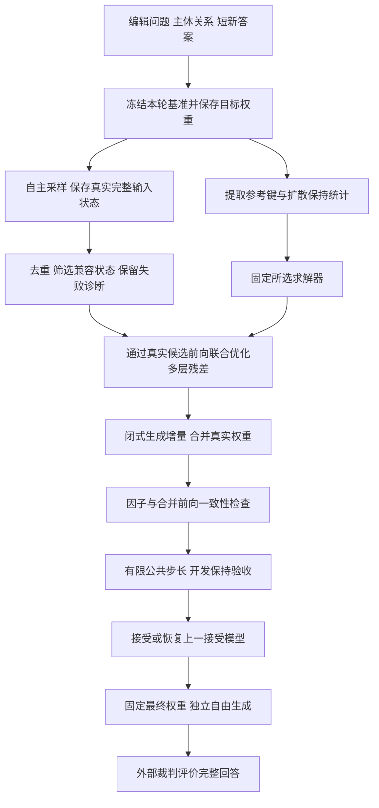

# 扩散知识编辑模型

整理日期：2026 年 10 月 15 日。范围：短答案监督下的掩码扩散语言模型知识编辑，以及自回归知识编辑方法的适配。本文交付方法与工程规格；真实编辑后端尚未实现，已有矩阵核验和模型加载记录不构成编辑效果证明。

目标是给定主体、关系和短新答案，计算一组固定参数更新，使模型在后续自由去噪中调用新事实，并保持不应改变的知识。最终完整回答按[外部大模型评测框架](C:/Users/admin/Documents/MDLM/技术文档/03_外部大模型评测框架.md)评价，数据按[数据集构建文档](C:/Users/admin/Documents/MDLM/技术文档/01_扩散知识编辑数据集构建.md)准备。

## 1 项目现状与方法版本

项目同时保存数条候选路线，不能拼接为一个已经确定并验证的算法。

| 路线 | 核心构造 | 当前证据与定位 |
| --- | --- | --- |
| 短答案锚定状态目标 | 由短答案读出构造参考向量及局部敏感子空间，再拟合状态目标 | 早期候选；局部投影不保证自由回答正确 |
| 完整方案 v1 | 对兼容状态计算全部调用位置的输出梯度，构造一步局部目标，分层闭式拟合 | 有小型合成核验；实质为预条件梯度编辑 |
| 9 月 23 日三文档汇编 | 通过实际候选权重反馈优化各层残差，再用所选求解核合并权重 | 可实现规格；10 月 9 日框架图采用此路线 |
| 全状态流式梯度方案 v0.2 | 构造轨迹的全部状态参与统计，汇总多层真实权重梯度后解析求解 | 独立候选；不筛掉冲突状态，与兼容状态路线不同 |
| 揭示事件驱动方案 | 每个目标位置在首次揭示前监督一次，聚合梯度后解析写入 | 独立候选；依赖单调揭示和目标位置对齐 |

下面先详细展开汇编路线，便于说明自回归求解器如何嵌入；第 6 节单列其他路线，不将其视为已被取代。具体实验采用哪条路线，必须写入运行配置和方法名称。

[长期上下文](C:/Users/admin/Documents/MDLM/RESEARCH_CONTEXT.md)的实现摘要截至 9 月 18 日；[10 月 9 日框架说明](C:/Users/admin/Documents/MDLM/outputs/research_framework_20261009/框架设计说明.md)引用 9 月 23 日汇编。文献监测报告中的项目概括不是算法版本的决定依据。

## 2 掩码扩散模型的编辑对象

### 2.1 层内表示与去噪状态

掩码扩散 Transformer 每次前向都有层内隐藏表示、注意力和 MLP 激活。标准无缓存采样通常将更新后的 token/mask 序列传入下一步，不直接递归传递上一步隐藏向量。

记去噪输入为 \(x_t\)，第 \(\ell\) 层表示为 \(h_\ell(x_t;\theta)\)。其中 \(t\) 表示去噪状态，\(\ell\) 表示网络层，\(\theta\) 为模型参数。二者不能混为同一种“状态”。

一次固定编辑在后续多次前向中反复生效，但每次输入和激活不同。去噪步数、前向调用数和有效计算量分别测量；引导分支、分块、缓存与加速都会影响它们。[LLaDA 官方生成实现](https://github.com/ML-GSAI/LLaDA/blob/main/generate.py)展示了基于 token/mask 序列的循环与分块条件；正式实验需固定代码提交。

### 2.2 可编辑线性模块

采用列向量约定：

\[
z_\ell=W_{b,\ell}k+b_\ell,\qquad
W_{b,\ell}\in\mathbb R^{d_{o,\ell}\times d_{i,\ell}}.
\]

这里 \(k\) 是目标线性层的实际输入；\(z_\ell\) 是输出；\(W_{b,\ell}\) 是本轮基准权重；\(b_\ell\) 为固定偏置；\(d_{i,\ell},d_{o,\ell}\) 分别是输入和输出维度。编辑增量与 \(W_{b,\ell}\) 同形，偏置默认不改。

这里的键是线性模块输入，不是注意力 Key，也不是短答案 token embedding。内部目标必须与该模块输出同空间，不能把残差流目标、答案 embedding 和 MLP 输出直接互换。

### 2.3 已登记的四个 backbone

下表描述[项目注册表](C:/Users/admin/Documents/MDLM/项目代码/mdlm_eval/models/registry.py)中的配置，不表示四个模型均已完成编辑实验。`{layer}` 与 `{expert}` 为实际索引占位符。

| 注册键 | 模型 | 默认改写模块 |
| --- | --- | --- |
| `llada` | LLaDA-8B-Instruct | `model.transformer.blocks.{layer}.ff_out` |
| `dream` | Dream-v0-Instruct-7B | `model.layers.{layer}.mlp.down_proj` |
| `illada` | iLLaDA-8B-Instruct | `model.layers.{layer}.mlp.down_proj` |
| `llada-moe` | LLaDA-MoE-7B-A1B-Instruct | `model.layers.{layer}.mlp.experts.{expert}.down_proj` |

已有[整模加载记录](C:/Users/admin/Documents/MDLM/中间过程文件/四模型整模加载验证.json)和[权重读取记录](C:/Users/admin/Documents/MDLM/中间过程文件/四模型全连接层权重验证.json)。它们支持当时的加载和模块访问结论，不证明当前机器可以无条件重现，也不证明编辑有效。

MoE 需要记录实际路由及被选专家；更新一个未被相关输入调用的专家不等于完成编辑。密集模型上的层号、保持统计与超参数不能直接搬到 MoE。

## 3 汇编路线的完整技术流程

### 3.1 从短答案构造训练状态

编辑训练使用与短答案 token 对齐的受控输出区域。用本轮基准模型自主采样，保存每次前向前的 token IDs、mask、位置、注意力、时间和分块条件，不向轨迹填入新答案。

对不重新掩码的受控短窗口，主训练集合保留仍有答案 mask，且已揭示答案 token 与目标兼容的状态：

\[
\mathcal T_i=\{t:\mathcal M_{i,t}\ne\varnothing,
\ x_{i,t,j}=a^*_{i,j}\ \forall j\in\mathcal A_i\setminus\mathcal M_{i,t}\}.
\]

其中 \(i\) 为事实编号；\(\mathcal A_i\) 是短答案的全部监督位置；\(\mathcal M_{i,t}\) 是其中仍被 mask 的位置；\(x_{i,t,j}\) 是实际可见 token；\(a^*_{i,j}\) 为目标 token；\(\mathcal T_i\) 为去重后的兼容状态集合。非空答案的全 mask 初态保留。

去重按模型实际使用的完整输入进行；即使可见文本相同，时间条件不同也不能随意合并。不兼容状态、零监督状态和终态全部保留诊断。此筛选是受控窗口的操作定义，不是任意 remasking 采样器的可达性定理。

### 3.2 两级归一的短答案损失

\[
L_{i,t}(\theta)=-\frac1{|\mathcal M_{i,t}|}
\sum_{j\in\mathcal M_{i,t}}\log p_{\theta,j}(a^*_{i,j}\mid x_{i,t}),\qquad
F(\theta)=\frac1N\sum_{i=1}^N\frac1{|\mathcal T_i|}
\sum_{t\in\mathcal T_i}L_{i,t}(\theta).
\]

这里 \(N\) 是事实数；\(p_{\theta,j}\) 是候选模型在位置 \(j\) 的原始预测分布；\(L_{i,t}\) 是单状态剩余 mask 损失；\(F\) 先在事实内按兼容状态平均，再对事实平均。其余符号沿用上一式。该目标不是完整序列的精确生成似然。

短答案只提供内容监督；主体和关系来自问题。微批梯度必须保留这一全局权重，不能将每批均值直接相加而改变事实权重。

### 3.3 参考键与固定写回核

汇编默认每条事实、每个编辑模块取一列参考键：全 mask 初态下主体最后一个 token 的 FFN 输出线性层输入。主体须能正确对齐；其他取键规则作为显式配置。

以带 ridge 的 MEMIT 核变体为例：

\[
H_\ell=C_\ell+K_\ell K_\ell^\top+\lambda_\ell I,
\qquad H_\ell X_\ell=K_\ell,
\qquad Q_\ell=X_\ell^\top,
\qquad \Delta W_\ell(R_\ell)=R_\ell Q_\ell.
\]

其中 \(K_\ell\in\mathbb R^{d_{i,\ell}\times N}\) 为固定参考键；\(C_\ell\) 是包含保持尺度的半正定未中心化二阶统计；\(\lambda_\ell>0\) 是本项目显式加入的 ridge；\(I\) 为输入空间单位阵；\(H_\ell\) 为正定系数矩阵；\(X_\ell\) 是线性系统解；\(Q_\ell\in\mathbb R^{N\times d_{i,\ell}}\) 为固定右因子；\(R_\ell\in\mathbb R^{d_{o,\ell}\times N}\) 为待优化残差。

保持统计应在该扩散模型的保持输入及掩码上下文上重新提取，并记录归一方式。不能复用另一个自回归模型的矩阵。各层分别准备、检查求解器；不显式计算逆矩阵。

多状态监督同一批残差，不自动要求每状态增加一列参数。默认键列数等于事实数；全状态键属于另一种规模与约束设计。

### 3.4 让残差经过实际候选权重反馈

\[
\theta(R)=\theta_b\oplus\{\Delta W_\ell(R_\ell)\}_{\ell\in\mathcal L},
\qquad
J(R)=F(\theta(R))+\beta L_{\mathrm{keep}}(\theta(R))
+\frac12\sum_{\ell\in\mathcal L}\rho_\ell\|R_\ell\|_F^2.
\]

其中 \(R\) 是全部层残差；\(\theta_b\) 是本轮冻结基准；\(\mathcal L\) 为编辑模块集合；\(\oplus\) 表示仅在指定矩阵合并增量；\(F\) 为短答案损失；\(L_{\mathrm{keep}}\) 为训练保持损失；\(\beta\ge0\)、\(\rho_\ell>0\) 为权重；\(\|\cdot\|_F\) 为 Frobenius 范数；\(J\) 是残差优化目标。

固定右因子时，可用下式实现真实候选前向：

\[
(W_{b,\ell}+R_\ell Q_\ell)k+b_\ell
=W_{b,\ell}k+b_\ell+R_\ell(Q_\ell k).
\]

这里 \(k\) 是当前候选网络在任意实际调用位置的输入；\(W_{b,\ell},b_\ell\) 为冻结基准；\(R_\ell,Q_\ell\) 分别为残差和固定因子。临时分支必须覆盖真实权重会作用的全部调用位置，只在主体位置注入一个向量不满足此等价式。

所有编辑层在同一候选网络中生效。虽然参考键固定，后层的实际输入仍随前层更新变化。基准权重冻结不等于关闭自动微分；必须保留从输出损失到残差的完整梯度链路。

残差按有限优化预算更新；各微批结束后释放计算图，同一步内累积梯度时残差数值保持不变，正则每步计一次。有限步得到的 \(R^*\) 只是选出的候选，不代表全局最优。

### 3.5 合并、验收与回退

\[
V_\ell^*=W_{b,\ell}K_\ell+R_\ell^*,\qquad
W_{\alpha,\ell}=W_{b,\ell}+\alpha R_\ell^*Q_\ell.
\]

其中 \(V_\ell^*\) 是去偏置线性输出空间内定义的有效目标；\(R_\ell^*\) 为有限优化候选；\(\alpha>0\) 为所有层共享、来自预定有限序列的试步；\(W_{\alpha,\ell}\) 为实际合并权重。其余符号沿用前文。软拟合不保证 \(W_{1,\ell}K_\ell=V_\ell^*\)。

每次试步都从本轮基准重建全部矩阵。先关闭临时因子分支，核验相同输入下与合并权重的 logits 在预定精度容差内一致，再执行：

\[
F_{\mathrm{dev}}(\theta_\alpha)\le
F_{\mathrm{dev}}(\theta_b)-\delta,\qquad
G_{\mathrm{dev}}(\theta_\alpha)\le\tau_G,\qquad
U(\theta_\alpha)\le\tau_U.
\]

这里 \(F_{\mathrm{dev}}\) 为开发编辑损失；\(G_{\mathrm{dev}}\) 是固定保持输入上相对最初模型的完整词表 KL 漂移；\(U\) 是相对最初模型的累计参数变化；\(\delta>0\) 为改善门槛；\(\tau_G,\tau_U\) 为保持和变化上限；\(\theta_\alpha\) 为真实合并候选；\(\theta_b\) 为本轮基准。阈值与步长在独立测试前固定，数值有限性和逐层更新检查同样必需。

全部试步失败则恢复上一接受模型。默认一轮；若预先允许最多刷新一次，第二轮须重新采样、取键、建统计并清零残差，保持参考仍是最初模型。第二轮失败保留首轮已接受模型。

上述验收不保证一定存在合格候选。汇编路线不能借用早期负梯度目标的一阶下降定理。开发损失改善、候选被接受、短答案生成正确、自由回答语义正确是四类不同结果。

## 4 自回归知识编辑方法的适配

### 4.1 迁移边界

迁移对象是编辑方法，不是把自回归模型本身转换成扩散模型。需要在目标扩散模型上重建输入键、监督损失、保持统计、模块位置和历史信息。

[已有扩散知识编辑研究](https://arxiv.org/html/2606.03924v2)已讨论 locate-then-edit 迁移及部分掩码修正，因此直接套用 MEMIT 或加入 partial-mask 状态本身不能作为本项目的独创结论。

适配分两种身份：

| 身份 | 含义 | 命名要求 |
| --- | --- | --- |
| 尽量保留原方法的扩散适配 | 保留原目标构造、分层分配或附加模块，仅改为扩散输入与监督 | 逐项交代必须改变的机制 |
| 复用求解核的项目变体 | 用第 3 节残差反馈优化替换原目标阶段 | 明确标为该求解核的扩散残差变体 |

### 4.2 方法覆盖与保留条件

| 方法 | 可复用部分 | 必须单独适配或验证的部分 |
| --- | --- | --- |
| ROME、r-ROME、p-ROME | 单键精确写回核 | 上下文平均键与无前缀键的一致性，非零键与保持矩阵 |
| EMMET | 多键硬等式约束 | 列秩、目标可行性；稳定化后的约束误差 |
| MEMIT | 批量软拟合核 | 原多层目标分配；额外 ridge 须显式声明 |
| PMET | 与 MEMIT 相近的软拟合核 | 双模块目标优化、FFN 写回、剩余层数平方根分配 |
| AlphaEdit | 保持输入空间的零空间投影 | 扩散保持谱、历史键与投影顺序 |
| NSE | 选择输入神经元坐标后求解 | 在扩散激活上重选坐标；历史统计与选择规则 |
| MALMEN | 输出变化的正则最小二乘聚合 | 超网络在扩散表示和梯度分布上的适配 |
| O-Edit | 对目标优化加入历史及通用梯度约束 | 原相似度正则与项目代理不可混称 |
| O-Edit+ | 对实际更新进行输出空间投影 | 投影后再评价；与 AlphaEdit 输入投影区分 |
| DeltaEdit | 根据历史干扰限制残差输出空间 | 动态触发与批量触发规则 |
| RECT | 对更新按相对变化稀疏化 | 非光滑后处理、零分母处理、重新验收 |
| PRUNE | 对累计更新奇异值进行变换 | 累计参考起点、后处理成本与历史保持 |
| AnyEdit | 任务分块与基础编辑器组合 | 原长目标文本并未由本任务提供；状态分块是新增变体 |

这些方法不是同一个逆矩阵公式的不同名称，也未全部在本项目实现。详细逐式来源保留在[自回归迁移汇编](C:/Users/admin/Documents/MDLM/output/pdf/研究方案汇编_20260923/02_自回归模型迁移文档.md)。

### 4.3 三个基础写回公式

以下省略层标，统一令 \(W\in\mathbb R^{d_o\times d_i}\) 为基准权重，\(K\in\mathbb R^{d_i\times n}\) 为扩散参考键，\(R\in\mathbb R^{d_o\times n}\) 为该方法确定的残差，\(C\) 为含保持尺度的二阶统计。\(n\) 为键数，\(d_i,d_o\) 为输入和输出维度。公式中的逆仅作数学记号，实现使用适当线性求解。

**ROME 单键核：**

\[
\Delta W=\frac{r k^\top C^{-1}}{k^\top C^{-1}k}.
\]

这里 \(k\ne0\) 是单个参考键，\(r\in\mathbb R^{d_o}\) 是单列残差，\(C\succ0\) 为正定保持统计；\(\Delta W\) 是权重增量。满足 \(\Delta Wk=r\)。r-ROME 与 p-ROME 须在分子、分母和目标中使用同一个键定义。原始核来源为 [ROME](https://arxiv.org/abs/2202.05262)。

**EMMET 多键硬约束核：**

\[
\Delta W=R(K^\top C^{-1}K)^{-1}K^\top C^{-1}.
\]

其中 \(K,R,C\) 沿用统一记号，\(C\succ0\)，普通逆形式要求 \(K\) 列满秩，因而 \(n\le d_i\)。此时 \(\Delta WK=R\)。若列相关，必须满足 \(Kc=0\Rightarrow Rc=0\) 的可行性条件；\(c\) 为任意键列系数向量。给中间 Gram 矩阵加 ridge 通常破坏精确等式，应报告拟合误差。来源为 [EMMET 统一框架](https://aclanthology.org/2024.findings-emnlp.903/)。

**MEMIT 软拟合核：**

\[
\Delta W=RK^\top(C+KK^\top)^{-1}.
\]

其中 \(K,R,C\) 沿用统一记号，要求括号内矩阵可逆或明确声明退化处理。该核折中目标拟合与保持扰动，通常 \(\Delta WK\ne R\)。第 3 节在此核上显式增加 \(\lambda I\)，并改变目标优化流程。来源为 [MEMIT](https://arxiv.org/abs/2210.07229)；原完整多层方法不止这一公式。

多个 ROME 单键增量直接求和，会在其他键上产生交叉作用，不能据单键等式宣称联合精确写入。批量方案应使用多键求解，或按明确顺序重算模型与键。

### 4.4 投影、选列与多层机制

AlphaEdit 的输入空间投影可以在正交基上实现：

\[
\Delta W=RK^\top U
\left[U^\top(KK^\top+K_hK_h^\top)U+I_s\right]^{-1}U^\top.
\]

其中 \(U\in\mathbb R^{d_i\times s}\)、\(U^\top U=I_s\) 为允许更新的输入子空间基；\(K_h\) 为历史编辑键；\(I_s\) 为 \(s\) 维单位阵；\(R,K,\Delta W\) 沿用统一记号。该写法对应原单位正则的子空间核，约化系统正定。来源及原式见 [AlphaEdit](https://arxiv.org/abs/2410.02355)。

不能对原公式中一般不对称的括号直接套用 Cholesky。保护性质仅针对被排除空间内的固定保持键；近零阈值、上游表示变化和自由生成都超出严格不变保证。

NSE 将输入坐标选择矩阵固定后，在选中子矩阵求解，未选权重列不更新。O-Edit+ 和 DeltaEdit 的输出空间限制则作用于更新左侧或残差，不能与 AlphaEdit 的输入侧投影混淆。

原 MEMIT/PMET 的逐层剩余目标分配与第 3 节“多层同时反馈优化”不同。若保留原顺序路线，应在前层修改后重算后层键和剩余目标；若冻结参考键并联合优化局部残差，则公开项目变体身份。

### 4.5 其他自回归编辑基线

微调、LoRA、MEND、SERAC、上下文编辑也可纳入统一比较，但各自的目标与部署状态不同：

| 基线 | 扩散适配重点 | 部署分类 |
| --- | --- | --- |
| 有限步微调 | 使用掩码位置损失，限定参数白名单与保持约束 | 主干参数更新 |
| LoRA | 把低秩分支装到真实扩散模块，按相同短答案监督训练 | 适配器，或合并后的参数更新 |
| MEND | 适配扩散域梯度与编辑器训练分布 | 学习式参数编辑 |
| SERAC 等检索式方法 | 定义检索、路由和回答器的完整接口 | 外部记忆与附加模型 |
| 上下文编辑 | 新事实作为上下文提供给模型 | 推理期条件基线 |

上下文基线本身可以显式提供新事实，但必须单独标为有额外推理输入的配置；不能与本项目“只改参数后不给答案”的主协议混报。迁移一个已训练的自回归超网络，也不能默认无需重新训练或验证。

## 5 短答案向自由长回答的迁移

主训练链路解决的是受控位置上的短答案监督与参数写入；长回答中答案位置、措辞、额外断言和跨状态调用尚需独立验证。

正式生成时只提供问题和统一的自由生成预算，从全 mask 或模型原生初态开始，使用固定编辑权重。模型可在任意合法位置表达新事实，不需要填满窗口。新答案不作为前缀，不强制植入可见 token，不按短答案长度截断最终回答。

分别报告受控短答案成功、独立问题泛化、自由长回答目标事实成功和完整回答成功。若短窗口改善而自由回答不改善，应将其记为迁移缺口，不能用完整长答案微调悄然替换任务。

外部裁判仅用于评价。其自然语言标签不自动构成可微残差目标，也不自动进入强化学习或模型选择循环。

## 6 其他候选路线的独立规格

### 6.1 兼容状态的输出梯度目标

早期完整方案 v1 在兼容状态中，对目标矩阵全部有效调用位置定义：

\[
e_{i,t,p}^{(\ell)}=\frac{\partial L_{i,t}}{\partial z_{i,t,p}^{(\ell)}},\qquad
r_{i,t,p}^{(\ell)}=-\eta_\ell e_{i,t,p}^{(\ell)},\qquad
v_{i,t,p}^{*(\ell)}=z_{i,t,p}^{(\ell)}+r_{i,t,p}^{(\ell)}.
\]

其中 \(p\) 遍历全部有效模块调用位置；\(z\) 为模块输出；\(e\) 为短答案损失对输出的梯度；\(\eta_\ell>0\) 为目标步幅；\(r\) 为局部修正；\(v^*\) 为局部代理目标。\(i,t,\ell\) 分别表示事实、状态、层。输入—修正外积累计后，闭式更新等价于相应的预条件参数梯度方向。

该路线的一阶性质依赖完整梯度、固定表示点和正确权重。平均损失下降不保证每事实准确率提高；[可行性审查](C:/Users/admin/Documents/MDLM/ccfa-review-reports/mdlm-closed-form-method-review.md)保存了相关反例。它与第 3 节迭代残差优化不是同一算法。

### 6.2 全状态流式梯度聚合

[全状态方案](C:/Users/admin/Documents/MDLM/全状态流式梯度知识编辑方案.md)不跳过构造轨迹状态；无有效答案 mask 的状态梯度为零，但仍进入输入统计。冲突状态不被过滤。其每层解析更新为：

\[
G_\ell=\sum_t a_t\nabla_{W_\ell}\ell_t,\qquad
C_\ell=\sum_t a_tK_{t,\ell}K_{t,\ell}^\top,\qquad
\Delta W_\ell=-G_\ell(\rho_\ell C_\ell+\mu_\ell C_{0,\ell}+\lambda_\ell I)^{-1}.
\]

其中 \(\ell_t\) 为该状态剩余合法 mask 的平均损失；\(a_t=1/T\)，\(T\) 为轨迹待去噪状态数；\(G_\ell\) 是汇总权重梯度；\(K_{t,\ell}\) 按列保存全部有效位置输入；\(C_\ell\) 为编辑输入统计；\(C_{0,\ell}\) 为保持统计；\(\rho_\ell,\mu_\ell\ge0\)、\(\lambda_\ell>0\) 为代理系数；\(I\) 为输入单位阵。

所有梯度在同一个参数点计算，每状态一次反向可同时取得全部指定层的梯度。分层二次代理忽略跨层二阶项；正定性仅保证代理解唯一及相应一阶方向性质。其“全状态”只指已构造轨迹，不是全部可能状态。

### 6.3 揭示事件驱动的梯度聚合

[揭示事件方案](C:/Users/admin/Documents/MDLM/揭示事件驱动的多层闭式知识编辑_方法.md)在单调揭示下，为每个目标位置选择首次揭示前的状态：

\[
\mathcal L_{\mathrm{evt}}(\theta)
=-\frac1n\sum_{j\in J^*}
\log p_{\theta,j}(y_j^*\mid x_{\tau(j)}).
\]

其中 \(J^*\) 为固定目标位置集合，\(n=|J^*|>0\)；\(\tau(j)\) 为位置 \(j\) 首次揭示的执行步；\(y_j^*\) 为短答案标签；\(x_{\tau(j)}\) 是揭示前输入；\(p_{\theta,j}\) 为位置预测分布。

每个目标 token 恰好监督一次，事件损失不再额外除以轨迹步数。全部状态仍进入按状态平均的输入统计，再使用梯度代理核。事件掩码只限定输出监督位置，不截断中间层其他位置的梯度。

在目标位置初始被 mask、最终全部揭示且不重掩码时，有监督事件反向次数不超过目标位置数与状态数的较小者；轨迹构造、全部状态重放、统计和求解成本仍存在。重掩码、提前终止或动态窗口需要另定事件协议。

### 6.4 固定目标的流式拟合

若键、目标残差和权重均已固定，可累计：

\[
A_\ell=\sum_u w_u r_{u,\ell}k_{u,\ell}^\top,\quad
B_\ell=\sum_u w_u k_{u,\ell}k_{u,\ell}^\top,\quad
\Delta W_\ell(B_\ell+C_\ell+\lambda_\ell I)=A_\ell.
\]

其中 \(u\) 为配对样本编号；\(w_u\ge0\) 为固定权重；\(r_{u,\ell},k_{u,\ell}\) 为固定残差与键；\(A_\ell\) 是交叉统计；\(B_\ell\) 是输入二阶统计；\(C_\ell\) 为含尺度的保持统计；\(\lambda_\ell>0\) 为 ridge；\(\Delta W_\ell\) 是更新。该式是固定目标软拟合的正规方程。

不能只相加残差，不能把不同基准模型的键值混在一起，也不能把第 3 节不断变化的优化残差当成一次固定统计处理。

## 7 工程接口与资源要求

### 7.1 已有代码与待补模块

| 现有位置 | 实际能力 | 待补内容 |
| --- | --- | --- |
| [模型加载器](C:/Users/admin/Documents/MDLM/项目代码/mdlm_eval/models/loader.py) | 加载模型和 tokenizer，默认冻结参数并进入 eval | 真实采样适配器与版本清单 |
| [架构访问器](C:/Users/admin/Documents/MDLM/项目代码/mdlm_eval/models/access.py) | 根据注册模板定位模块与权重 | 白名单、共享存储与实际调用检查 |
| [编辑协议](C:/Users/admin/Documents/MDLM/项目代码/mdlm_eval/interfaces.py) | 单案例 apply/revert 接口 | 真正参数编辑、批量应用、快照与故障恢复 |
| [模拟编辑器](C:/Users/admin/Documents/MDLM/项目代码/mdlm_eval/editors/mock.py) | 修改内存映射 | 仅作流程测试，不是权重编辑 |
| [模拟生成器](C:/Users/admin/Documents/MDLM/项目代码/mdlm_eval/adapters/mock.py) | 按测试元数据返回确定答案 | 仅作测试；真实模型不能读取这些参考字段 |
| [运行入口](C:/Users/admin/Documents/MDLM/项目代码/scripts/run_mdlm_eval.py) | 固定实例化模拟后端和模拟编辑器 | 真实配置、编辑方法和裁判加载入口 |

拟议接口应向编辑器提供专用编辑视图，而不是含全部测试题的 `EvalCase`；对真实生成器提供不含答案的推理视图。批量编辑须显式声明事务边界和撤销机制，不能把当前逐案例接口直接称为联合批量实现。

### 7.2 参数与梯度管理

保存唯一参数白名单，记录名称、层号、矩阵方向、dtype、设备和共享存储。第一版可拒绝不支持的绑定参数；不能把同一存储按不同名称重复写入。

残差路线冻结基准权重，训练临时残差；直接梯度路线仅对指定矩阵求梯度。两者都须保持冻结中间层的必要反向链路。`eval()` 不会关闭求导，整个前向使用 `no_grad()` 则会使目标梯度失效。

全部候选准备和检查完成后统一提交。任一层写入失败，恢复全部白名单矩阵；恢复失败立即停止，避免污染后续案例。独立编辑、联合批量与连续编辑分别定义模型生命周期。

### 7.3 内存与计算

固定因子路线每层的残差与右因子大小分别为 \(O(d_oN)\) 和 \(O(Nd_i)\)；稠密保持矩阵与系数矩阵为 \(O(d_i^2)\)。流式固定目标或梯度路线还保存输出—输入统计或梯度，规模为 \(O(d_od_i)\)。其中 \(N\) 为事实数，\(d_i,d_o\) 为该模块维度。

以上均未计模型权重、激活、优化器状态、原权重备份、候选矩阵、求解工作区和 CPU 转移。状态逐批释放主要控制激活驻留，不保证总体内存恒定或更省，也不保证总时间更短。

资源分别报告轨迹构造、保持统计准备、候选前反向、外积累计、分解求解、合并验收和独立评价。冷启动与缓存复用分开；不能只报告最后闭式求解的时间。

## 8 最小实现验收与实验安排

先在单事实、单层、小状态集上核验，再扩展多状态、多事实、多层。单层是实现检查与消融，不替代全状态多层路线自身的定义。

必要检查包括：

1. 实际模板、主体位置、短答案 token 和模型 logits 对齐正确。
2. 自主采样输入不含标准答案；保存的状态可以一致重放。
3. 小例残差梯度或权重梯度与独立参考计算一致，未切断跨层链路。
4. 因子候选与真实合并前向一致，临时分支移除后只剩预期参数变化。
5. 求解残差、谱尺度、有限值和更新范数达标；小求解残差不能替代病态诊断。
6. 多层部分写入失败能整体恢复；独立案例结束后恢复基准。
7. 开发验收与最终测试隔离，拒绝或失败案例不从总体分母消失。
8. 外部语义裁判完成校准，完整自由回答与短答案链路分别报告。

首轮比较至少包含 no-edit、短答案有限步微调或 LoRA、直接扩散 MEMIT、部分掩码强基线及所选项目候选。比较状态机制时匹配层集合、监督用途和优化预算，并公开额外计算量。其他自回归方法逐一接入，不把来源论文不同设置下的数字当作复现结果。

本次整理时，现有 33 项单元与集成测试通过，覆盖模拟流程、指标、裁判回调、恢复和权重访问工具。测试未执行真实模型知识编辑；环境另出现 PyTorch 初始化 NumPy 的警告，后续数值实验应先核验相应依赖环境。

## 9 来源与可主张范围

| 项目材料 | 用途 |
| --- | --- |
| [三文档汇编算法](C:/Users/admin/Documents/MDLM/output/pdf/研究方案汇编_20260923/01_算法文档.md) | 第 3 节实际候选残差优化、有限验收与流式备选 |
| [三文档汇编模型方案](C:/Users/admin/Documents/MDLM/output/pdf/研究方案汇编_20260923/03_模型方案文档.md) | 研究目标、模块、短窗口与长窗口边界 |
| [完整方案 v1](C:/Users/admin/Documents/MDLM/短答案驱动的多事实多状态多层闭式编辑_完整方案_v1.md) | 输出梯度局部目标路线 |
| [全状态方案](C:/Users/admin/Documents/MDLM/全状态流式梯度知识编辑方案.md) | 全状态多层梯度代理路线 |
| [揭示事件方法](C:/Users/admin/Documents/MDLM/揭示事件驱动的多层闭式知识编辑_方法.md) | 事件监督与归一方式 |
| [矩阵核验记录](C:/Users/admin/Documents/MDLM/output/pdf/closed_form_transfer/数学核验结果_20260923.json) | 小型矩阵约束、正规方程和因子等价性 |

可主张的是具有明确条件的候选算法、适配接口和已有工程检查。真实短答案编辑成功率、长窗口语义迁移、保持效果、批量扩展、资源优势及新颖性仍需要对应实验与文献证据。闭式的是条件化线性子问题，不是短答案到整网行为的全局解析解。
