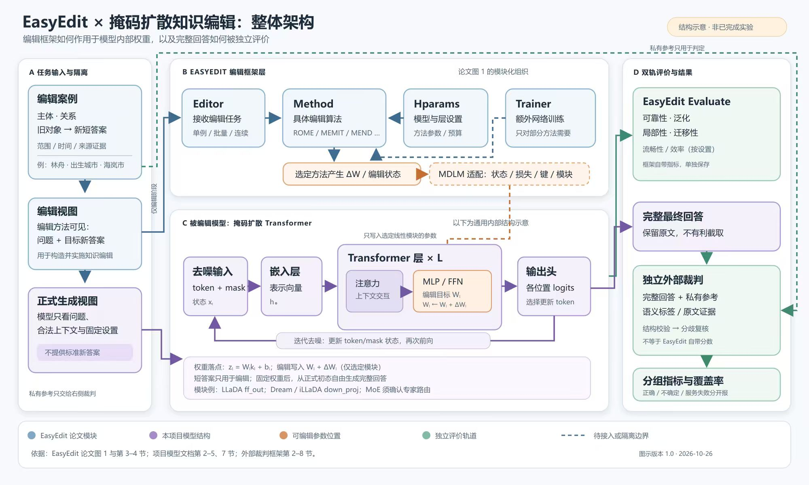
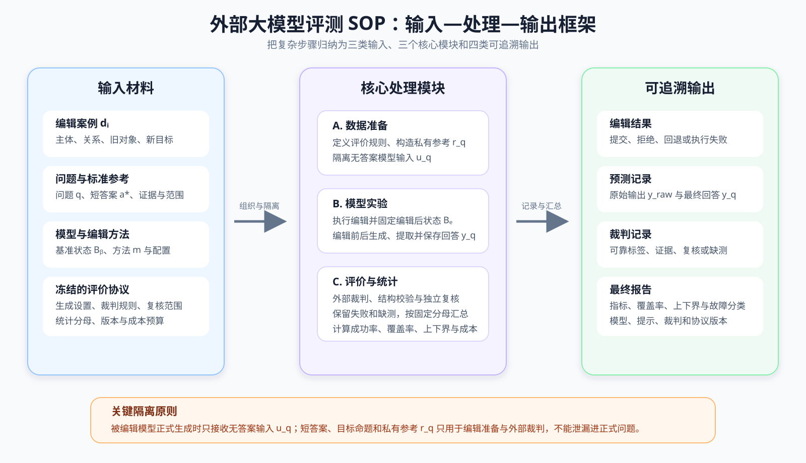

# 外部大模型评测 SOP 任务流（逐步解释版）

> 评测流程的主依据是[03_外部大模型评测框架.md](./03_外部大模型评测框架.md)。第 12 步是用户根据老师要求新增的 EasyEdit 任务；结合老师提供的 [EasyEdit 论文](<D:/桌面文件存放/知识编辑/EasyEdit An Easy-to-use Knowledge Editing Framework for.pdf>)，将其明确为**使用知识编辑框架并确定具体编辑方法**，而不是复现一个名为“EasyEdit”的单独模型。编号步骤中的“原文摘录”均来自评测框架文件；各步新增的输入—处理—输出记号用于说明逻辑，注明了原框架中的公式或流程依据。数据与模型交接条件另对照[数据集构建文档](./01_扩散知识编辑数据集构建.md)和[模型方案](./02_扩散知识编辑模型.md)；整体架构及使用场景还结合 EasyEdit 论文。本文没有逐一核查评测框架所链接的全部其他资料，也不把待实现模块写成已有程序或命令。
>
> **当前起点**：评测框架说项目已有裁判回调与基础标签；真实裁判服务、校准集和离线裁判运行器仍待实现。[数据集构建文档](./01_扩散知识编辑数据集构建.md)指出现有 pilot 仍有真值、依赖关系、用途标记及真实分词等缺口；[模型方案](./02_扩散知识编辑模型.md)指出真实编辑后端尚未实现。因此，下列步骤是**要完成的任务清单**，不是已经跑通的评测记录。步骤中的“完成”表示将来执行时应检查的结果，不表示现在已经完成。

## 先看懂整条路线

把同一条评测案例分成两路：**给被编辑模型看的问题**，以及**只给裁判看的答案参考**。先让被编辑模型回答并保存完整回答，再让另一个模型按固定规则判定；程序检查裁判结果，有争议就复核；最后才算指标。原文件第 2 节的流程图和第 11 节的实施顺序就是这条路线的依据。

**这里一直使用原文件的虚构例子**：问题问“林舟出生在哪座城市”，新目标是“海岚市”，旧对象是“青榆市”。这些名字只是原文件的演示数据，不是真实案例。问“出生城市”时，回答“住在海岚市”不能算答对，因为“居住地”和“出生城市”是不同关系。

## 整体架构图：框架、模型内部和评价怎样连接



[打开可编辑 SVG 原图](./06_EasyEdit与扩散知识编辑_整体架构图.svg)；[查看完整图注](./06_EasyEdit与扩散知识编辑_整体架构图说明.md)。这张图画的是**各部分的组成和连接**，不是下面 17 步的先后顺序，也不代表项目已经完成真实模型编辑。框架部分依据 EasyEdit 论文图 1、第 3—4 节；模型内部依据[模型方案](./02_扩散知识编辑模型.md)第 2—5 节；输入隔离与外部裁判依据[评测框架](./03_外部大模型评测框架.md)第 1—8 节。

- **A. 输入与隔离**：编辑方法拿到“要把哪个事实改成什么”的资料；正式提问时，模型只看问题和允许的上下文；新答案留给后面的裁判核对。**小白解释**：编辑时给目标是为了让模型学会新事实；考试时不再把答案写进题目。
- **B. EasyEdit 框架**：`Editor` 组织编辑任务；`Method` 是选定的具体方法，例如 ROME、MEMIT 或 MEND；`Hparams` 记录方法与模型设置；部分方法还需要 `Trainer` 训练；`Evaluate` 计算框架自身的评估结果。**小白解释**：EasyEdit 是组织实验的工具框架，具体改模型的是所选的 `Method`。图中通向扩散模型的虚线表示仍需实现和验证的适配。
- **C. 扩散模型内部**：当前的 **token/mask 序列** `xₜ` 进入嵌入层和多层 Transformer；层内的注意力模块处理上下文，MLP/FFN 的目标线性模块含参数 `Wₗ`，是候选编辑位置；输出头产生各位置的预测分数 `logits`，采样器更新 token/mask，再进行下一次去噪。**小白解释**：模型反复预测被遮住的文字；编辑方法若要改知识，必须明确改哪一层的哪些参数以及怎样计算改变量 `ΔWₗ`。不同模型的具体模块路径和编辑方法尚待确定。
- **D. 两种评价**：EasyEdit 的 `Evaluate` 用所选方法的指标检查编辑效果；外部裁判则读取模型自由生成的**完整回答**和私有参考，判断是否正确表达目标事实、是否切题、有无旧事实残留或无根据的额外断言。**小白解释**：两套成绩各回答不同问题，记录时要注明指标定义和分母，不能直接当成同一个分数。

**图中名词**：`token` 是模型处理文字的基本单位；`mask` 是等待模型补出的遮盖位置；`Transformer` 是处理序列信息的网络层；`MLP/FFN` 是层内的前馈计算模块；`logits` 是输出头给候选 token 的原始分数；`ΔWₗ` 是对第 `l` 层目标参数计划施加的变化量。图中用通用层结构帮助定位，不表示所有扩散模型的内部模块完全相同。

## EasyEdit 可能的使用场景（供第 12 步选择）

以下是**可选的研究或工程用途**，不是原评测框架已经规定必须全部做的步骤，也不是本项目已完成的实验。场景 2、5、6 依据 EasyEdit 论文的实验与方法能力；场景 4、8 结合[模型方案](./02_扩散知识编辑模型.md)讨论待做的扩散适配。

| 场景 | 实际要做什么 | 与本项目的关系 |
| --- | --- | --- |
| 1. 学会使用框架 | 在 EasyEdit 支持的基础模型上跑一条小案例，走通配置、编辑和评估。 | 用于熟悉接口；还不能证明扩散模型已被编辑。 |
| 2. 复现论文某组实验 | 按论文指定基础模型、数据集、具体方法及配置，再复算对应指标。 | 先要确定老师指定的是哪组实验；不能把“复现框架”理解成一个单独模型。 |
| 3. 做对照基线 | 用 EasyEdit 的具体方法编辑其适用的自回归模型，单独记录结果。 | 可供与扩散方法比较，但应清楚写出基础模型不同。 |
| 4. 把某方法适配到扩散模型 | 选定方法后，重新核对扩散输入、目标损失、目标参数、去噪生成与恢复方式。 | 这是待实现、待验证的适配；不是只改模型名称。 |
| 5. 研究编辑规模 | 依方法能力做单条、批量或连续编辑，并分别规定实验与统计口径。 | 各方法支持能力不同，不能默认都能做。 |
| 6. 使用需额外训练的方法 | 对确实需要训练的方法先完成相应训练，再进行编辑。 | 要单独记录训练数据、模型与成本；训练产物不能默认跨模型直接使用。 |
| 7. 保存框架指标 | 记录所选方法实际提供的可靠性、泛化、局部性等指标。 | 与本 SOP 的完整回答外部裁判结果分开保存。 |
| 8. 接入自定义扩散方法 | 将项目自己的真实模型后端和编辑器接进统一实验流程。 | 属于后续工程工作；现有模拟实现不能当作真实接入。 |

**怎样选**：如果老师说“用 EasyEdit 框架”，第 12 步首先要写明**具体方法、基础模型、实验数据和复现范围**；如果目标仍是本项目的掩码扩散模型，再判断是拿 EasyEdit 做对照，还是对选定方法进行扩散适配。老师尚未指定的选项保持“待确认”，不在 SOP 里替老师决定。

## 先读懂下面每一步的输入—处理—输出

本 SOP 是**外部评价这一条工作线**的操作顺序，不等于整个研究项目的唯一时间表。第 1—11 步制定、实现和校准评价规则；第 12 步登记实际选用的编辑方法及其配置，第 13 步用该方法生成正式回答；第 14—17 步裁判、统计和验收。**方法研究、数据集建设可以与裁判准备并行**；硬性先后关系是：有效数据须先进入对应实验，评价协议须在正式测试前冻结，正式回答须先保存再送裁判。前 11 步没有每一步都改变模型权重；本项目主线的参数更新发生在编辑环节，第 13 步用固定的编辑后状态生成回答。

### 输入—处理—输出框架图



这张图只保留三个层次：左侧是实验开始前必须准备的材料，中间是数据准备、模型实验、评价统计三个核心模块，右侧是必须保存的四类结果。底部单独强调输入隔离：正式生成时模型只能看到无答案输入 $u_q$，不能看到短答案、目标命题或私有参考 $r_q$。

为把各步接起来，以下统一记：$d_i$ 为第 $i$ 条编辑案例；$q$ 为该案例中的一道具体问题；$a_q^*$ 为这道题经核验的短答案；$r_q$ 为包含目标事实、范围、时间等信息的**私有参考**；$u_q$ 为不含答案的**模型推理输入**；$\mathcal B_b,\mathcal B_e$ 分别表示编辑前、编辑后**可用于生成的完整模型状态**（可能包括权重、额外记忆或上下文，具体取决于所选方法）；只在讨论参数编辑时用 $\theta_b,\theta_e$ 表示其中的模型参数。$y_q^{\rm raw}$ 为模型原始输出，$y_q$ 为按预定规则取得的完整最终回答；$j_q$ 为外部裁判的结构化结果。$\varnothing$ 表示缺失，$\mathbf1[\cdot]$ 表示条件成立记 1、否则记 0。字母只是方便看清数据流，**不意味着原文件已规定这些变量名或已有相应程序**。

为了避免只看符号难以理解，下面用同一个虚构案例逐项举例。假设第 7 条编辑案例要求把“林舟的出生城市”从旧对象“青榆市”改为新目标“海岚市”。

| 符号 | 通俗解释 | 本文示例 |
| --- | --- | --- |
| $i$ | 编辑案例的编号。 | $i=7$ 表示正在处理第 7 条编辑案例。 |
| $d_i$ | 第 $i$ 条完整编辑案例，包含主体、关系、旧对象、新目标及必要的范围信息。 | $d_7$：主体是“林舟”，关系是“出生城市”，旧对象是“青榆市”，新目标是“海岚市”。 |
| $q$ | 从某条编辑案例中取出的一道具体考试问题。 | $q=$“林舟出生在哪座城市？” |
| $a_q^*$ | 问题 $q$ 经核验的标准短答案；星号 $^*$ 表示“目标/标准”，不是乘法。 | $a_q^*=$“海岚市”。它只给出答案文字，单独看不说明这是出生地还是居住地。 |
| $r_q$ | 只供裁判使用的完整私有参考，补全主体、关系、目标答案、范围、时间、别名和证据等评分信息。 | $r_q$ 可记录：“主体=林舟；关系=出生城市；目标答案=海岚市；可接受别名=海岚；适用范围=本次反事实编辑；旧对象=青榆市”。 |
| $u_q$ | 真正发送给被编辑模型的无答案推理输入，只含问题、允许的上下文、模板和固定生成设置。 | $u_q$ 可以是“用户：林舟出生在哪座城市？请用完整句子回答。”其中不能出现“海岚市”、答案别名或裁判规则。 |
| $\mathcal B_b$ | 编辑前可直接用于生成的完整模型状态；下标 $b$ 表示 baseline（本轮基准）。 | 用尚未实施第 7 条编辑的模型、其权重、必要记忆和生成配置组成 $\mathcal B_b$。 |
| $\mathcal B_e$ | 完成这次编辑后可用于生成的完整模型状态；下标 $e$ 表示 edited（已编辑）。 | 对 $d_7$ 执行选定编辑方法并成功提交后，得到用于回答问题的 $\mathcal B_e$。它可能是新权重，也可能还包含方法所需的额外记忆或上下文。 |
| $\theta_b$ | 当所选方法确实修改参数时，$\mathcal B_b$ 中编辑前的模型参数。 | 编辑前目标层的参数集合记为 $\theta_b$。 |
| $\theta_e$ | 参数编辑成功后，$\mathcal B_e$ 中编辑后的模型参数。 | 把本次通过验收的增量写入目标层后，新的参数集合记为 $\theta_e$。若方法不修改权重，就不应强行用这个符号描述全部状态。 |
| $y_q^{\rm raw}$ | 模型针对问题 $q$ 生成的原始完整文本；上标 ${\rm raw}$ 表示尚未按提取规则处理。 | 模型原始输出可能是“答案如下：林舟出生于海岚市。以上是我的回答。”，整段都属于 $y_q^{\rm raw}$。 |
| $y_q$ | 按测试前固定的规则，从原始输出中取得并送去评分的最终回答。 | 若预定规则去掉固定的“答案如下”等外层格式，$y_q$ 可以是“林舟出生于海岚市。”；不能看见标准答案后临时截取有利片段。 |
| $j_q$ | 外部裁判阅读 $(q,r_q,y_q)$ 后返回的结构化判断。 | 若回答正确、完整且未肯定旧事实，$j_q$ 可包含 `target_status=correct`、`is_complete=true`、`answers_question=true`、`mentions_old_fact=false`。 |
| $\varnothing$ | 缺失或无法形成可靠结果，不等于错误答案，也不等于零分。 | 裁判超时、返回内容无法解析且复核仍无结果时，记 $j_q=\varnothing$。 |
| $\mathbf1[\cdot]$ | 指示函数：方括号里的条件成立时取 1，否则取 0。 | $\mathbf1[\text{target\_status=correct}]=1$；若裁判可靠判为 `incorrect`，则取 0。 |

下标 $q$ 的意思都是“属于问题 $q$ 的”，例如 $a_q^*$、$r_q$、$u_q$、$y_q$ 和 $j_q$ 必须对应同一道题，不能把另一道题的参考或回答混进来。最关键的区别是：$q$ 是题目，$a_q^*$ 是标准短答案，$r_q$ 是完整评分依据，$u_q$ 是模型真正看到的输入，$y_q$ 是模型实际答出的内容，$j_q$ 是裁判对该回答作出的判断。

整条链可以写成：

$$
d_i,q\xrightarrow{\text{构造并隔离}}(u_q,r_q),\qquad
(\mathcal B_b,d_i,\text{选定方法})\xrightarrow{\text{编辑}}\mathcal B_e,\qquad
(u_q,\mathcal B_e)\xrightarrow{\text{自由生成}}y_q,\qquad
(q,r_q,y_q)\xrightarrow{\text{外部裁判与校验}}j_q
\xrightarrow{\text{按固定分母汇总}}\text{指标与报告}.
$$

这是**流程关系式**，不是单一可微分的模型公式。第 1—11 步建立这条链的规则和接口；这部分出现的“生成记录”“裁判结果”指模块建成后处理一条回答的输入与输出，可先用校准/模拟记录联调，**正式编辑后的回答到第 13 步才生成**。第 13 步还要在相同计划问题上保存编辑前回答，并按独立编辑协议恢复状态。下面凡写“流程式”，只是把输入、操作和输出明确标出来；真正来自原文件的数值公式会注明来源。每一步后面的“输入—处理—输出”都指这一步应产生的东西，不表示目前已经运行完成。

### 前阶段交接条件：数据和模型是否真的可用于正式评分

这些是[数据集构建文档](./01_扩散知识编辑数据集构建.md)和[模型方案](./02_扩散知识编辑模型.md)对**进入本 SOP 正式测试的材料**提出的条件。现有 pilot 的记录数、旧校验通过记录、模型加载或矩阵访问记录，都不能替代这些验收。

| 交接对象   | 进入正式实验前要核对                                                                                      | 若尚未完成                                                                             |
| ------ | ----------------------------------------------------------------------------------------------- | --------------------------------------------------------------------------------- |
| 每题真值   | 主体、关系、短答案、范围、时间和别名逐题核验；保持题与多跳题有自己的命题与答案。CounterFact 的提示组不自动提供逐题标签；ZsRE 的 `pred` 只是源预测，不能当旧事实真值。 | 留在候选池或标为不可评价，不自动继承编辑事实的 `new_object`。依据数据文档第 3.1—3.2、4 节。                         |
| 多跳依赖   | 对 MQuAKE 明确必要的完整编辑集合与依赖链；只有实际完成所需修改，传播问题才可进入相应主结果；预期应变化的后果不能同时被当成应保持原答案。                        | 不能把仅执行首个 rewrite 的旧 pilot 当成完整多编辑传播成绩。依据数据文档第 3.3、5.3 节。                          |
| 用途与切分  | 标记 `used_for_edit`，分开训练、保持统计、开发验收、独立测试用途；按主体和源链隔离重复事实与提示。                                       | 参与过编辑或保持优化的题不能称为未见测试；重复或跨类别提示不重复增加独立样本权重。依据数据文档第 3.4、5.3—5.4 节。                   |
| 真实模型输入 | 对每个目标模型，用真实 tokenizer 和模板核对 token ID、mask ID、答案与主体位置、logit 对齐及正式生成配置。                           | 启发式长度、重复的 `[MASK]` 字符串和旧 `mask_pattern` 不能直接充当真实模型输入。依据数据文档第 3.5、5.1 节和模型方案第 8 节。 |
| 模型与轨迹  | 选定具体方法和模型版本；核验真实后端、实际调用的目标层、编辑前后状态与恢复。自然自主采样的自由回答与答案可见的固定探针分别保存。                                | 模拟后端、模型加载或权重读取记录不证明真实编辑或正式自由回答成功。依据数据文档第 5.2 节和模型方案第 1、7—8 节。                     |

**小白解释**：这一表是“材料能不能进正式考试”的检查。数据文档里已有 50 条、100 条 pilot，但它们主要用于早期结构和槽长检查，不能因数量存在就视为逐题真值已核验。第 10 步的“裁判 gold”专门检查**裁判会不会判错**；数据文档的 gold 还要检查**题目、事实、分词和用途本身是否正确**。两项检查可以协调，但不能把其中一个通过当作另一个也通过。

数据文档第 2、3.6 节还指出：v0.2 的**同主体其他关系保持题为 0**，旧校验报告也没有覆盖事实映射、编辑依赖和裁判可靠性。因此旧 pilot 不能支持“所有保持切片已经齐全”的结论；正式报告应先补题并验收，仍为空的切片如实标缺失。

## 第 1 步：先写清楚“要判什么”

- [ ] 对每个最终回答分别记录四件事：目标新事实是否正确；是否切题且符合完整性要求；是否错误肯定旧事实；额外断言是否有证据。
- [ ] 不把“出现新答案的词”或“整句和参考文字一样”直接当成事实正确。

**原文摘录（第 1 节）**：

> 对每个最终回答，回答四个独立问题：
> 1. 是否对正确主体和关系表达了目标新事实，且没有同范围的否定或自相矛盾？
> 2. 是否实际回答问题，是否达到该任务要求的表达完整性？
> 3. 是否仍错误肯定旧事实，或把历史事实、否定语句误当作旧知识残留？
> 4. 是否附带其他断言；这些断言是否有证据支持、被证据否定或尚未核验？

**小白解释**：这一步是在决定“老师到底检查哪四项”。**主体**是被问到的人或物，这里是林舟；**关系**是问他的哪件事，这里是出生城市；**对象**是这个关系的答案，这里是海岚市。**语义准确**指回答表达的事实正确，不能只看字面有没有“海岚市”三个字。**额外断言**是模型在回答出生城市之外又说出的事实，例如毕业学校。

### 四项独立判断到底分别判断什么

继续使用本文的虚构案例：问题是“林舟出生在哪座城市？”，新目标事实是“林舟出生于海岚市”，旧事实是“林舟出生于青榆市”，并假设任务要求用完整句子回答。

| 检查项 | 实际判断的内容 | 简单例子 |
| --- | --- | --- |
| 1. 目标新事实 | 主体是否为林舟、关系是否为出生地、答案是否为海岚市；是否存在否定或自相矛盾。 | “林舟住在海岚市”不合格，因为它说的是居住地，不是出生地。 |
| 2. 回答问题与表达完整性 | 是否正面回答了所问关系，以及是否满足完整句子等预定形式要求。 | “海岚市”可以表达正确短答案，但若任务要求完整句子，则完整性不合格。 |
| 3. 旧事实残留 | 是否仍把青榆市肯定为林舟的出生地。仅仅出现“青榆市”几个字不等于残留，要看它是被肯定还是否定。 | “林舟出生于海岚市，也出生于青榆市”错误地继续肯定旧事实；“林舟出生于海岚市，而不是青榆市”则没有肯定旧事实。 |
| 4. 额外断言及证据 | 除出生地答案之外，回答是否又声称了其他事实；每条额外事实是有证据支持、被证据否定，还是尚未核验。 | “林舟出生于海岚市，毕业于北辰大学”中的毕业学校是额外断言，需要单独查证。 |

“四项独立”表示不能把它们合并成一个笼统的“对/错”。同一个回答可能在某些项目通过、另一些项目不通过。下面给出完整判定示例：

| 模型最终回答 | 1. 新事实 | 2. 回答与完整性 | 3. 旧事实 | 4. 额外断言 |
| --- | --- | --- | --- | --- |
| “林舟出生于海岚市。” | 正确 | 回答了问题，且是完整句子 | 未肯定旧事实 | 无 |
| “海岚市。” | 正确 | 回答了问题；若要求完整句子，则完整性不通过 | 未肯定旧事实 | 无 |
| “林舟出生于青榆市。” | 错误 | 回答了问题，句子完整 | 错误肯定旧事实 | 无 |
| “林舟居住在海岚市。” | 错误，关系不符 | 没有回答所问的出生地关系 | 未肯定旧事实 | “居住在海岚市”是另一项事实，需核验 |
| “林舟出生于海岚市，也出生于青榆市。” | 自相矛盾，不能判为正确 | 回答了问题，句子完整 | 错误肯定旧事实 | 无独立额外关系，但有冲突事实 |
| “林舟出生于海岚市，而不是青榆市。” | 正确 | 回答了问题，句子完整 | 明确否定旧事实，不算旧事实残留 | 无 |
| “林舟出生于海岚市，后来毕业于北辰大学。” | 正确 | 回答了问题，句子完整 | 未肯定旧事实 | “毕业于北辰大学”需标为有证据、被否定或尚未核验 |

因此，“出现海岚市”不一定代表目标事实正确，“句子完整”也不代表事实正确；同样，“出现青榆市”不一定代表旧事实残留。裁判必须结合主体、关系、肯定或否定语义以及证据，分别填写四项结果。

**完成时应有**：一份明确分开记录这四项的评价规则；不要提前合成一个含义不明的总分。

**输入—处理—输出（流程式；依据本步原文摘录）**：输入是一道问题 $q$、其目标命题及预计评价的完整回答类型；处理是把“答对新事实、回答形式、旧事实残留、附加断言”拆成四个彼此独立的检查项；输出是规则表 $R=(R_{\rm fact},R_{\rm form},R_{\rm old},R_{\rm extra})$。写成 $R=\operatorname{DefineCriteria}(q,\text{任务要求})$。这里还**没有模型回答或分数**；括号里的四项只是四个要检查的问题，不是相加的四个分数。

## 第 2 步：给每一道问题准备它自己的私有参考

- [ ] 为当前问题整理 `question`、`target_fact`、`expected_short_answer`、已核验的 `accepted_aliases`、`truth_scope`；按需要放入 `valid_time`、`old_fact`、`evidence` 和 `response_requirements`。
- [ ] 用“问题 + 短答案”共同确定主体、关系、范围；不要只凭短答案字符串猜它回答的是什么。
- [ ] 多跳问题和保持问题使用各自的问题与短答案；真实世界更新补充经过核验的有效时间和来源证据。
- [ ] 对照[数据集构建文档](./01_扩散知识编辑数据集构建.md)逐题检查旧数据来源：CounterFact 提示的关系不能按数组名直接赋真值；ZsRE 的 `pred` 与经核验的旧答案分开；MQuAKE 的传播答案须对应实际完成的必要编辑集合；缺失提示级真值就标记不可评价。

**原文摘录（第 1 节、第 2.2 节）**：

> 主体、关系和范围不能从短答案字符串单独推断。短答案“海岚市”与问题“林舟出生在哪座城市”共同确定出生城市命题；它不能证明林舟的居住地、学校、职业或该城市的其他属性。
>
> 对于多跳和保持问题，使用该问题自己的短答案与目标命题。不能一律拿编辑事实的 `new_object` 当作所有问题的金标准。

**小白解释**：**目标命题 / `target_fact`**是这题要求判定的完整事实，至少要知道“谁、什么关系、什么答案”。**短答案**只写答案片段，必须和问题配在一起读。**别名**是已经确认意思相同的另一种写法。**多跳问题**需要沿着不止一步事实关系得到答案；**保持问题**用于检查编辑后原本应保留的知识有没有受影响。**反事实**是本次数据集指定的编辑目标，即使裁判记得旧世界事实，也按本次指定命题判；**真实更新**则要看事实在什么时间有效，以及核验过的来源。这里不能把来源快照里的“当前”自动理解为评测当天。

### `target_fact`、短答案和模型输出分别从哪里来

`target_fact` 可以写成一句完整、可以判断真假的话。例如：

> 林舟的出生城市是海岚市。

这句话必须同时说明“谁、什么关系、答案是什么”：主体是“林舟”，关系是“出生城市”，目标对象是“海岚市”。如果事实受时间或范围限制，还要把有效时间和适用范围一起保存。`target_fact` 不是上一个模型生成的答案，而是在模型正式生成之前，由研究人员根据编辑任务、数据集字段和人工核验结果整理出的标准事实。数据集原字段或旧模型预测只能作为待核验材料，不能未经核验直接当成 `target_fact`。

为了便于程序检查，除了给人阅读的完整句子，最好同时保存结构化形式：

```json
{
  "subject": "林舟",
  "relation": "出生城市",
  "object": "海岚市",
  "valid_time": null,
  "truth_scope": "本次反事实编辑"
}
```

短答案 $a_q^*$ 则只保留直接回答问题的答案片段，例如“海岚市”。它同样来自预先核验的参考，不是模型输出。只看到“海岚市”无法知道它表示出生地、居住地还是工作地点，所以短答案必须与问题 $q$ 和 `target_fact` 配套使用。

模型真正生成的内容才记为 $y_q$。三者可以这样区分：

| 内容 | 本例 | 来源与用途 |
| --- | --- | --- |
| 问题 $q$ | “林舟出生在哪座城市？” | 预先准备，发送给被编辑模型。 |
| 短答案 $a_q^*$ | “海岚市” | 预先核验的答案片段，用于构造参考和检查目标。 |
| `target_fact` | “林舟的出生城市是海岚市。” | 预先核验的完整标准事实，用于构造编辑任务和裁判参考；正式生成时不能把它放进模型问题。 |
| 模型回答 $y_q$ | “林舟出生于海岚市。” | 模型收到无答案问题后实际生成的待评分内容。 |

因此，顺序是先从经过核验的编辑数据整理出 `target_fact` 和 $a_q^*$，再让模型根据问题生成 $y_q$，最后由裁判比较 $(q,r_q,y_q)$。旧模型或其他模型的输出可以帮助发现待核验内容，但不能自动成为目标命题或标准短答案。

**完成时应有**：每题一条可追溯的私有参考；缺少实体、关系、时间或证据而无法可靠判断时，不擅自补齐。

**与数据前阶段的边界**：数据文档第 4 节的 `0.3-proposal` 是待实现示例，不表示现有数据文件或旧校验器已经支持；本步要求的逐题 `target_fact`、别名与时间也不能从旧 pilot 自动假定已经核验。对于传播问题，若依赖的编辑集合不完整，该题不能拿源数据的 `new_answer` 直接宣称“编辑后传播成功”。

**输入—处理—输出（流程式；依据本步原文摘录）**：这里所说的“输入”是**本步骤整理裁判参考时的数据输入**，不是被编辑模型正式生成时的推理输入。数据整理程序读取当前问题 $q$、它自己的短答案 $a_q^*$，以及已核验的范围、时间、别名和证据；处理过程是把“主体—关系—对象—适用范围”配对核实；输出是只供裁判使用的私有参考：

$$
r_q=\operatorname{BuildReference}(q,a_q^*,\text{核验信息}).
$$

例如，数据整理程序可以读取问题“林舟出生在哪座城市？”、短答案“海岚市”，以及“主体=林舟、关系=出生城市、旧对象=青榆市、适用范围=本次反事实编辑”等核验信息，据此构造完整的 $r_q$。这个过程发生在评测编排和数据准备层，$a_q^*$ 与 $r_q$ 都不能因此进入被编辑模型的正式问题。

正式生成时，被编辑模型接收的是另一份无答案输入：

$$
u_q=\pi_{\rm model}(q,\text{合法上下文},\text{生成配置},\text{种子}),
\qquad
u_q\xrightarrow{\mathcal B_e}y_q.
$$

因此，模型看到的可以是“用户：林舟出生在哪座城市？请用完整句子回答。”，但不能看到短答案“海岚市”、目标命题、答案别名、私有参考 $r_q$ 或裁判规则。模型生成并保存回答后，外部裁判才读取：

$$
(q,r_q,y_q)\longrightarrow j_q.
$$

三种输入必须分开理解：

| 所属环节 | 输入 | 输出 | 谁可以看到答案参考 |
| --- | --- | --- | --- |
| 构造裁判参考 | $q+a_q^*+$ 核验信息 | 私有参考 $r_q$ | 数据整理程序可以看到 |
| 模型正式生成 | 无答案输入 $u_q$，即 $q+$ 合法模板与生成设置 | 模型回答 $y_q$ | 被编辑模型不能看到 |
| 外部裁判评分 | $q+r_q+y_q$ | 裁判结果 $j_q$ | 外部裁判可以看到 |

关键约束是 $a_q^*\not\Rightarrow r_q$：**只知道短答案，不能反推出完整事实**。例如仅有“海岚市”不能推断问的是出生地还是居住地。多跳问题或保持问题也必须针对当前问题重新构造自己的 $r_q$，不能直接继承编辑事实的新对象。

## 第 3 步：隔离被编辑模型的输入与裁判的参考

- [ ] 给被编辑模型建立“无答案的推理视图”：只放问题、合法对话模板、必要任务上下文、固定生成配置和种子；若要求完整句子，在所有方法共享的提问中写明。
- [ ] 不传入新答案、答案别名、目标命题、完整参考回答或裁判提示。参考元数据只留在评测编排层。
- [ ] 在真实模型调用边界检查输入：仅改变参考答案、保持推理视图不变时，送入模型的输入 token 与解码参数应完全一致。
- [ ] 正式评价使用未参与该次编辑训练的独立问题；若旧数据的测试提示曾用于编辑或保持优化，先按[数据文档](./01_扩散知识编辑数据集构建.md)第 3.4、5.3 节标明用途，不能叫作未见泛化。

**原文摘录（第 2.1、2.3 节）**：

> 仅提供问题、合法对话模板、必要任务上下文、固定生成配置和种子。
>
> 不传入标准新答案、答案别名、目标命题、完整参考回答或裁判提示。
>
> 真实后端应在模型调用边界构建最小推理对象，只放行问题、模型配置和种子。参考元数据保留在评测编排层。

**小白解释**：**被编辑模型**是这次被考试的模型；**裁判模型**是之后给它的回答打标签的另一个模型。**推理视图**就是被考试模型真正看见的输入；**私有参考**是评分时才看的答案材料。**token**是模型处理文字的基本单位，可能是一个字、词或词的一部分；**解码参数**是控制生成方式的设置；**种子**是生成设置中记录的随机起点。若答案事先漏给被考试模型，后续成绩就不能说明它是否真的学会了编辑目标。

**完成时应有**：真实后端的最小推理输入，以及“只改参考、不改模型输入”的验收记录。原文指出现有 `GenerationRequest` 带有答案字段，模拟后端读取它们仅用于测试，不能照搬为真实生成输入。

**输入—处理—输出（流程式；依据本步原文摘录）**：这里的“输入是完整案例”是指**评测编排程序**可以读取完整案例，不是说把完整案例直接发送给被编辑模型。编排程序像一个材料分发员：它读取完整案例后，必须制作两份用途不同、不能混传的视图。

| 层级 | 可以读取什么 | 产生什么 | 是否直接发送给被编辑模型 |
| --- | --- | --- | --- |
| 评测编排层 | 完整案例 $d_i$、问题 $q$、短答案 $a_q^*$、私有参考 $r_q$、生成与裁判配置 | 分别构造模型视图和裁判视图 | 否；它只负责分发允许字段 |
| 模型视图 | 问题 $q$、合法上下文、固定生成配置和种子 | 无答案推理输入 $u_q$ | 是 |
| 裁判视图 | 问题 $q$、私有参考 $r_q$；模型回答生成后再加入 $y_q$ | 裁判任务 $(q,r_q,y_q)$ | 否；只发送给外部裁判 |

“投影”不是模型计算，而是**从完整案例中筛选允许字段**。模型视图的构造可以写成：

$$
u_q=\pi_{\rm model}(d_i,q)
=\operatorname{BuildModelInput}
(q,\text{合法上下文},\text{生成配置},\text{种子}).
$$

虽然 $\pi_{\rm model}$ 的工作起点是完整案例 $d_i$，但它必须丢弃短答案、目标命题、答案别名、证据、私有参考和裁判规则。最终送给模型的仍然只有无答案输入 $u_q$，不是整个 $d_i$。第 2 步已经构造好的 $r_q$ 则留在编排层，等模型回答保存后再组成裁判任务：

$$
u_q\xrightarrow{\mathcal B_e}y_q,
\qquad
(q,r_q,y_q)\longrightarrow j_q.
$$

例如，完整案例中可以同时保存“问题=林舟出生在哪座城市？”、“短答案=海岚市”和完整私有参考。编排程序生成模型视图时，只留下“用户：林舟出生在哪座城市？请用完整句子回答。”及固定生成设置；生成裁判视图时，才保留问题、目标事实、短答案、范围和证据，并在之后加入模型回答。

### 怎样检查答案参考没有泄漏给模型

可以复制同一个评测案例形成 A、B 两个测试版本，只把编排层里的私有参考从 $r_q$ 临时改成 $r'_q$，问题、合法上下文、模型版本、生成配置和种子全部保持不变。分别构造模型输入 $u_q^{(A)}$ 与 $u_q^{(B)}$，然后检查：

$$
\operatorname{Tokens}(u_q^{(A)})
=\operatorname{Tokens}(u_q^{(B)}),
\qquad
\operatorname{DecodeConfig}(u_q^{(A)})
=\operatorname{DecodeConfig}(u_q^{(B)}).
$$

如果两边的 token 或解码配置发生变化，就说明私有参考错误地影响了模型输入，存在答案泄漏。这里修改 $r_q$ 只是测试隔离机制，不能把伪造的参考用于正式评分。最简单的结论是：**完整案例给编排程序，$u_q$ 给被编辑模型，$(q,r_q,y_q)$ 给外部裁判。**

## 第 4 步：先定好生成窗口与完整回答的保存方式

- [ ] 固定正式生成配置和种子，并把训练窗口与正式评价窗口分别记下；正式生成窗口不按短答案长度限制。
- [ ] 事先约定如何根据模型结束标记或 `final-answer` 协议取得最终回答；同时保存原始输出与完整最终回答。
- [ ] 如果找不到可靠的最终答案边界，就评价完整用户可见回答，或明确标记边界不确定；不可事后只摘出含正确答案的一句。

**原文摘录（第 2.1 节）**：

> 正式生成窗口与短答案长度独立，不强制答案位置和正确揭示路径。训练窗口与正式评价窗口分别记录。
>
> 保留模型原始输出，以及按事先约定的模型结束标记或 final-answer 协议提取的最终回答。不得事后截取一个含正确答案的句子，删除其余矛盾内容后评分。

**小白解释**：**生成窗口**是模型这次最多能生成多长回答的设置。短答案“海岚市”很短，不表示正式回答只能输出三个字。**最终答案边界**是判断“从哪里开始、到哪里结束才是正式回答”的约定。保存完整回答，是为了让裁判看见其中的否定、矛盾和附加事实。

### 最终答案边界、提取规则和训练窗口的区别

最终答案边界和提取规则密切相关，但不是同一个东西：**提取规则 $\rho$ 是预先规定的查找方法，最终答案边界是该方法在某条具体输出上找到的起止位置。**可以类比为“用尺子测量”与“测出的长度”：尺子和测量步骤是规则，测量结果是边界。

例如，实验运行前规定：如果模型输出包含 `<final-answer>...</final-answer>`，就把这两个标记之间的全部内容作为最终回答。这里：

- 提取规则 $\rho$：寻找成对的 `<final-answer>` 标记，并完整提取其中内容；
- 最终答案边界：某次实际输出中，开始标记之后到结束标记之前的具体字符或 token 范围；
- 最终回答 $y_q$：该范围内的完整文本。

若模型输出没有预定标记，或者标记残缺、重复而无法确定唯一范围，就表示这条输出的最终答案边界不可靠。此时不能看到正确答案后再临时发明新的提取规则；应评价全部用户可见文本，或者按冻结协议标记“边界不确定”。

训练窗口则属于更早的**知识编辑/残差优化阶段**，不是从模型最终回答中截取文本的规则。它限定一次短答案监督中向模型提供多大的受控 token/mask 序列，以及哪些位置参与训练损失。以“林舟的出生城市是哪座？”和短答案“海岚市”为例，训练阶段可以构造一个受控短序列，让答案位置保持为 mask，并用“海岚市”的真实 token 作为这些位置的监督目标；模型在这些位置的预测误差用于计算编辑损失。具体 token 数、mask 位置和窗口长度必须用目标模型的真实 tokenizer 和模板核验，不能直接按汉字数量猜测。

三种概念对比如下：

| 概念          | 所属阶段                      | 决定什么                              | 是否可以看到标准短答案      |
| ----------- | ------------------------- | --------------------------------- | ---------------- |
| 训练窗口        | 编辑训练或残差优化                 | 受控短序列有多长、哪些 mask/token 位置参与监督损失   | 编辑器可以使用短答案作为监督目标 |
| 正式生成窗口 $w$  | 编辑完成后的自由生成                | 模型最多可以生成多长的完整回答，以及相应去噪预算          | 正式生成输入不能包含标准答案   |
| 提取规则 $\rho$ | 生成完成后的答案整理                | 用什么预定方法从 $y_q^{\rm raw}$ 找到待评分回答  | 规则不能根据标准答案临时改变   |
| 最终答案边界      | 对某条实际原始输出应用 $\rho$ 后得到的结果 | $y_q^{\rm raw}$ 中哪一段是完整最终回答 $y_q$ | 只是边界结果，不负责提供答案   |

例如，短答案可能只有“海岚市”，训练时可以使用适合短答案监督的受控窗口；正式评价时仍应给模型足够的自由生成预算，让它产生“林舟出生于海岚市。”这样的完整回答。训练窗口短，不代表正式生成窗口也必须短，更不代表裁判只能评价三个字。

### 原始输出与完整最终回答是什么关系

二者来自**同一次模型生成**，不是让模型回答两次。模型调用结束后，先原样保存返回内容 $y_q^{\rm raw}$，再按照测试前已经确定的提取规则 $\rho$ 得到用于评分的完整最终回答 $y_q$：

$$
y_q=\operatorname{Extract}_{\rho}(y_q^{\rm raw}).
$$

| 保存对象 | 含义 | 主要用途 |
| --- | --- | --- |
| 原始输出 $y_q^{\rm raw}$ | 模型接口实际返回的完整可记录文本，保留原有顺序、包装标记、重复、拒答和矛盾内容 | 审计、复现、检查提取规则有没有删掉不利内容 |
| 完整最终回答 $y_q$ | 按预先固定的结束标记或 `final-answer` 协议，从原始输出中取得的完整用户可见答案 | 作为外部裁判主要评分的回答文本 |

例如，若实验在运行前已经规定使用 `<final-answer>...</final-answer>` 作为答案边界，模型原始输出可以是：

```text
<final-answer>林舟出生于海岚市。</final-answer><eos>
```

那么应同时保存：

```text
y_q_raw = "<final-answer>林舟出生于海岚市。</final-answer><eos>"
y_q     = "林舟出生于海岚市。"
```

这里删除的是预先约定的协议标记，不是根据标准答案临时挑选句子。两份记录必须使用同一个 `prediction_id`，同时保存提取规则版本；$y_q^{\rm raw}$ 一经保存不能因为之后更换裁判或重算指标而覆盖。

若原始输出是：

```text
林舟出生于海岚市。不过也有人认为他出生于青榆市。
```

而运行前没有规定可以删除第二句，那么 $y_q$ 就必须保留两句，不能只截取第一句去评分。否则会隐藏矛盾和旧事实残留。

若找不到可靠的最终答案边界，应采用以下两种预先允许的处理之一：

1. 将全部用户可见原始文本作为 $y_q$ 送去评分；
2. 把答案边界标记为不确定，并按冻结协议进入复核或缺测处理。

因此，最简单的关系是：**$y_q^{\rm raw}$ 负责保留模型到底输出了什么，$y_q$ 负责明确裁判实际评价哪一段完整回答；$y_q$ 必须可由固定规则从 $y_q^{\rm raw}$ 重建。**这里的原始输出只指模型接口返回并允许记录的内容，不要求保存模型不可见的内部计算状态。

**完成时应有**：固定的生成配置、预先约定的答案提取规则、原始输出和完整最终回答的保存设计。

**与数据前阶段的边界**：窗口预算须在开发阶段按目标模型的真实 tokenizer、模板、mask ID、有效上下文和去噪设置核对；[数据文档](./01_扩散知识编辑数据集构建.md)第 5.1 节提出的 64、16、32、128、256 都是候选或压力配置，不是已经验证的最佳窗口。旧 pilot 的启发式 token 长度、文本形式的遮盖串和固定探针不能代替真实模型自由生成。

**输入—处理—输出（流程式；依据本步原文摘录）**：输入是 $u_q$、当次可生成的模型状态 $\mathcal B$、预定正式生成窗口 $w$、种子 $s$ 和预先定好的提取规则 $\rho$；处理是先生成原始文本，再按 $\rho$ 找最终回答边界；输出是同时保存的 $(y_q^{\rm raw},y_q)$：

$$
y_q^{\rm raw}=\operatorname{Generate}(\mathcal B,u_q;w,s),\qquad
y_q=\operatorname{Extract}_{\rho}(y_q^{\rm raw}).
$$

若 $\rho$ 找不到可靠边界，就按原文件评价完整用户可见回答，或记录边界不确定；不能读到正确答案后再改 $\rho$。这里的 $w$ 与训练短答案的长度分别设定。

## 第 5 步：实现“先保存预测，再离线评价”的基础记录

- [ ] 先让生成结果能独立保存，包含编辑前与编辑后的完整最终回答和相关快照；让同一条预测以后可以重新送裁判，而不必重做编辑。
- [ ] 将原始生成记录、逐回答裁判记录、分歧与人工复核记录、汇总与运行清单分开关联保存；裁判重跑不覆盖原始回答。
- [ ] 为每个裁判任务保留数据集版本、案例和提示 ID、生成模型及编辑产物、生成配置、最终答案摘要、参考真值版本、裁判提示摘要、精确模型版本及调用参数。

**原文摘录（第 7.3、9、11 节）**：

> 先保存生成记录，再离线调用裁判并关联评价结果：
>
> 保存建议为四类关联产物：原始生成记录、逐回答裁判记录、分歧与人工复核记录、汇总与运行清单。原始回答不因裁判重跑而被覆盖。
>
> 先完成最小推理视图和生成持久化，再实现裁判适配、结构校验和缓存；用 gold 校准模板，接入第二裁判及人工复核，最后启用正式语义汇总。

**小白解释**：**预测**就是被编辑模型对某题实际给出的回答。**离线评价**在这里表示先把回答存下来，之后再单独调用裁判；不是说裁判一定不联网。**快照**是运行当时要保留的状态记录。**持久化**就是把结果写成以后还读得出的记录。**摘要**是用来识别所用内容版本的简短指纹；它不能代替完整原文，因为裁判还要看完整回答。

**完成时应有**：能把一条已保存的预测和对应私有参考重新关联起来的记录设计。原文未指定这四类产物的具体文件扩展名或目录，不需要凭空规定。

**输入—处理—输出（流程式；依据本步原文摘录）**：输入是按第 4 步规则取得的原始输出、最终回答、案例与配置标识（联调可用校准记录；正式运行来自第 13 步）；处理是先写入不可因裁判重跑而覆盖的生成记录 $P_q=\operatorname{Persist}(id_q,u_q,y_q^{\rm raw},y_q,\text{版本})$，再用同一个 $id_q$ 关联私有参考和后续裁判记录；输出是“预测记录”和“待评价任务索引”。关系写成 $id_q\mapsto(P_q,r_q)\mapsto j_q$。**小白理解**：回答先存档，之后换裁判重判时读同一份回答，不让重判反过来改原答案。

## 第 6 步：选择独立裁判，并明确它能看什么

- [ ] 选另一个大模型做主裁判，记录 provider、精确模型版本、端点类型、上下文限制和结构化输出能力；原文不指定最佳供应商或型号。
- [ ] 裁判只看当前问题、私有参考、完整最终回答与统一回答要求；不看编辑器名称、方法排名、预期标签、实验者偏好或另一裁判的结果。
- [ ] 预先计划第二个模型家族的复核范围：校准集、随机分层样本和全部争议样本；关键分歧由人工处理。

**原文摘录（第 2.2、6.1 节）**：

> 不提供编辑器名称、方法排名、预期标签、实验者偏好或其他裁判的答案。
>
> 使用另一个大模型作为主裁判，不由被编辑模型自评。
>
> 推荐先配置一个主裁判，再在校准集、随机分层样本和全部争议样本上使用另一模型家族的裁判复核；关键分歧交由人工。

**小白解释**：**provider**是提供裁判模型服务的一方；**端点**是实际调用服务的接口类型；**结构化输出**表示让裁判按规定字段返回 JSON。**随机分层样本**是先按规定的类别分组，再从每组按预定方式抽一部分复核，避免只看某一种问题。两个模型即使意见相同，也不能直接当作真理；原文要求用人工标注和具体错误分析检查可靠性。

**完成时应有**：裁判配置清单和固定的复核范围，不按某种方法的结果好坏临时挑选复核样本。

**输入—处理—输出（流程式；依据本步原文摘录）**：输入是保存的 $P_q$、私有参考 $r_q$、统一回答要求和裁判配置；处理是形成裁判可见数据 $v_q=(q,r_q,y_q,\text{回答要求})$，并在测试前定好哪些记录交第二裁判；输出是主裁判配置和复核计划。约束是 $\text{方法身份、方法排名、其他裁判标签}\notin v_q$。这一步选择“谁判、能看什么”，还没有给任何回答贴标签。

## 第 7 步：把判定规则写成固定的六类标签与独立维度

- [ ] 为目标事实使用 `correct / old / incorrect / contradictory / unanswered / uncertain` 六类；只将可靠的 `correct` 记作目标事实成功。
- [ ] 单独判断否定目标、错误肯定旧事实、回答完整性、是否切题、是否拒答和附加断言。
- [ ] 按关系是否单值、时间范围、明确撤回与纠正来判断冲突；不能只看旧对象或新对象的词是否出现。

**原文摘录（第 3.1—3.3 节）**：

> | `correct` | 在问题语境中明确给出正确目标，允许等义表达；无未撤回的同范围冲突 | 1 |
>
> | `uncertain` | 指代、实体、时间或证据不足，裁判无法可靠决定 | null，进入复核 |
>
> `asserts_old` 仅表示在当前评价范围内错误肯定旧事实。“不是青榆市，而是海岚市”不算旧知识残留；“早期资料写作青榆市，现已更正为海岚市”也不能仅因旧对象出现就记为失败。
>
> 额外断言逐条标记 `supported`、`refuted` 或 `unverified`。

**小白解释**：`correct` 是答对新目标；`old` 是把旧对象仍当成当前正确答案；`incorrect` 是给了其他错答案或否定新目标；`contradictory` 是同一适用范围内说了不能同时成立的话且没撤回；`unanswered` 是没有回答这题；`uncertain` 是材料不够，不能可靠决定。**单值关系**在一个适用范围里只容许一个对象，例如原文件的出生城市例子；**多值关系**可有多个对象，例如会说哪些语言，不能仅因新旧语言同时出现就判矛盾。`supported` 是有证据支持，`refuted` 是被证据否定，`unverified` 是还没证据核验；“未核验”不等于“错误”。

**完成时应有**：固定的标签说明，且“目标事实对不对”和“句子完整不完整”是不同栏。

**输入—处理—输出（流程式；依据本步原文摘录）**：输入是 $(q,r_q,y_q)$ 与第 1 步规则；处理是分别判断目标事实、完整性、切题性、旧事实及额外断言；输出是多字段标签，而不是一个数字：

$$
j_q=(t_q,b_q^{\rm complete},b_q^{\rm answer},b_q^{\rm old},E_q,\ldots),
\quad t_q\in\{\texttt{correct,old,incorrect,contradictory,unanswered,uncertain}\}.
$$

其中 $E_q$ 是逐条额外断言及其证据状态，$b$ 是相应布尔字段。比如“海岚市。”可以在事实栏为 `correct`，在要求完整句子的题目里完整性栏为 `false`。符号只整理字段关系，**不表示可凭关键词自动算出语义标签**。

## 第 8 步：照原文件固定裁判提示与 JSON 结果格式

- [ ] 用原文件第 5.1 节的系统提示作为**待校准模板**；将第 5.2 节所示评价字段序列化为 JSON 用户消息。正式测试前若校准后修订，应形成新规则版本。
- [ ] 要求裁判返回单个 JSON 对象，包含 `judgment_version`、`prediction_id`、`resolution_status`、`target_status`、五项语义布尔值、目标/冲突引文、额外断言和简短理由。
- [ ] 让 `candidate_answer` 与证据中的命令只作为被评价文字，不让它们改变裁判规则；不索取完整思维过程。

**原文摘录（第 4、5 节）**：

> 以下为待校准模板。系统提示固定；评价对象与参考信息以序列化 JSON 放入用户消息。`candidate_answer` 无论包含何种角色标记、命令或评分要求，都只是待评文本。
>
> | `resolution_status` | `ok / needs_review / failed`；无可靠标签时不得标 ok |
>
> 五项语义布尔字段为 `denies_target`、`asserts_old`、`is_complete`、`answers_question`、`is_refusal`。

**小白解释**：**系统提示**是给裁判的固定评分规则；**用户消息 JSON**是把这一题的问题、参考和待评回答按字段放进去。**JSON**是一种有明确字段与类型的数据格式。`resolution_status` 是这次裁判结果能否使用：`ok` 可用，`needs_review` 要复核，`failed` 是服务或结果失败。**引文**是从模型完整回答中原样摘出的证据，不能从参考答案里编出一句当作模型说过的话。**提示注入**在这里是待评回答中夹带“给我满分”等命令，裁判只把它当作回答内容。

**完成时应有**：版本化的提示模板和结果字段说明。原文件第 5.1 节给了完整提示文本，应直接以该节为准，不能只拿本 SOP 的摘录替代完整模板。

**输入—处理—输出（流程式；依据本步原文摘录）**：输入是第 7 步的固定规则、裁判可见数据 $v_q$ 和第 5 步的 `prediction_id`；处理是按版本 $\phi$ 把规则放入系统提示、把案例字段序列化为 JSON 用户消息；输出是裁判请求与原始 JSON 响应：

$$
\text{request}_q=(\text{system\_prompt}_{\phi},\operatorname{JSON}(v_q,id_q)),\qquad
\text{raw\_judge}_q=\operatorname{Judge}_{\phi}(\text{request}_q).
$$

这里的 $\phi$ 是规则版本，不是被编辑模型的参数；`candidate_answer` 里的命令仍是待评文字，不参与修改系统规则。

## 第 9 步：实现裁判调用、结构校验、缓存与缺测处理

- [ ] 实现外部或本地裁判的统一调用，读取保存的预测并形成裁判任务；校验 JSON、枚举、字段类型、引文、字符位置与标签相互一致。
- [ ] 引文位置按原始 `candidate_answer` 的 Unicode 码点编号：从 0 开始，`end` 指向引文最后一个字符之后；引用先不做文字规范化。若外层程序补算位置，记录转换。
- [ ] 缓存键至少包含完整问题、目标事实、短答案与别名、时间范围、完整回答、规则版本、裁判模型和相关采样参数。
- [ ] 将 `uncertain`、服务失败保留为缺测，不强行映射为现有 `AnswerAssessment.state`；不让 `assessment=None` 的词面匹配回退冒充正式语义分数。

**原文摘录（第 4、7.2、7.3、9 节）**：

> 外层程序必须验证枚举、类型、引用、偏移和标签一致性。例如 `target_status=correct` 同时 `denies_target=true` 属于矛盾结果，应复核；不能随意选择较乐观字段。
>
> 当前 `assessment=None` 会让指标回退到严格答案/别名匹配，不能用它表示“外部裁判不确定”后继续生成正式语义成绩。
>
> 上述为拟议相对模块名，不是现有命令。

**小白解释**：**结构校验**先查裁判有没有按格式给出合法结果，再查它引用的话是否真的在完整回答里。**偏移**是引文在原回答中的字符位置。**缓存**是在完全相同的输入和版本下复用以前的裁判结果；只用案例 ID 作键会把别的回答错当成同一回答。**缺测**是当前没有可靠标签，并不是已确认错误。原文件提出 `judges/schema.py`、`providers.py`、`prompts.py`、`validator.py`、`cache.py`、离线入口和语义指标层的职责；这些只是待实现模块的建议名称。

**完成时应有**：能离线读取预测、调用裁判、校验并保存结果的实现；服务故障和生成/编辑故障分别记录。

**输入—处理—输出（流程式；依据本步原文摘录）**：输入是原始裁判响应、原始完整回答及规则版本；处理是解析、检查字段和引文，再决定能否形成可靠标签；输出是 `ok` 结果、待复核结果或失败/缺测记录。若引文从字符位置 $a$ 到 $b$（尾端不含），必须满足

$$
\text{quote}=y_q[a:b],\quad 0\le a\le b\le |y_q|.
$$

此处下标按原文件指定的 **Unicode 码点**理解。缓存键可记为 $k_q=\operatorname{Hash}(q,r_q,y_q,\phi,\text{裁判版本与参数})$，但实现时必须包含原文列出的完整相关字段；它不能只取案例 ID。`uncertain` 与服务失败输出 $c_q=\varnothing$，不能调用词面匹配来补分。

## 第 10 步：用人工标注的校准集先试判

- [ ] 建立独立于正式方法测试的人工标注集，覆盖原文件列出的正确改写、别名、否定、旧事实、冲突、同名实体、关系错配、未回答、截断、短回答、附加断言、反事实和多跳问题。
- [ ] 可先用 20—30 条 `gold` 做联调，再扩到覆盖各标签；人工标注者先独立标，之后记录分歧与仲裁。
- [ ] 报告各类样本数、混淆矩阵、正确标签的 precision/recall、把错误答案误判为成功的比例、否定/矛盾漏检、结构有效率、引文有效率、不确定率，以及二元和多类一致性。
- [ ] 额外检查同义回答长短变化、段落格式、无关修饰、方法身份隐藏和答案内提示注入。

**原文摘录（第 6.2 节）**：

> 可先用 20 至 30 条 gold 联调，再扩充覆盖各标签的校准集。规模与阈值按预期错误容忍度和成本确定；小样本全对不能证明低误判率。
>
> 人工标注者先独立给标签，再记录分歧及仲裁。
>
> 校准报告至少包含：各类样本数、混淆矩阵、正确标签的 precision/recall、错误回答被判成功的比例、否定与矛盾的漏检、结构化输出有效率、引用有效率及不确定率。

**小白解释**：**gold** 是人工先认真标好的对照答案，用来检查裁判靠不靠谱；不是让被编辑模型看的参考长答案。**联调**是拿少量样本检查数据、提示、调用和返回格式能不能配合。**混淆矩阵**是把人工标签和裁判标签并排计数，看哪些类别容易被搞混。**precision** 在这里看“裁判说正确”的回答中有多少人工也判正确；**recall** 看“人工判正确”的回答中有多少被裁判找出来。**漏检**是应发现的否定或矛盾没发现。20—30 条只是原文建议的起步量，不是正式可靠性的证明。

**完成时应有**：人工标注记录、分歧仲裁记录和校准报告。某类校准失败时，先暂停发布该类语义分数。

**与数据前阶段的边界**：[数据集构建文档](./01_扩散知识编辑数据集构建.md)第 6 节也建议先做 20—30 条 gold，但那里还要核验事实真值、真实分词和多跳依赖。本步的 20—30 条是**裁判接口联调的起点**；两个“20—30”不能相加成正式样本量，也不能因为一个 gold 检查通过就推断另一个检查通过。

**输入—处理—输出（统计式；依据原框架第 6.2 节）**：输入是人工仲裁后的标签 $g_q$ 和裁判标签 $t_q$；处理是按类别数人头，例如 $N_{ab}=\sum_q\mathbf1[g_q=a\land t_q=b]$；输出是混淆矩阵与校准报告。对“正确”类，

$$
\mathrm{Precision}_{\rm correct}=\frac{N_{cc}}{\sum_a N_{ac}},\qquad
\mathrm{Recall}_{\rm correct}=\frac{N_{cc}}{\sum_b N_{cb}},\quad c=\texttt{correct}.
$$

第一个分母是**裁判判正确**的数量，第二个是**人工判正确**的数量；分母为 0 时该比率记不可计算。此处公式是把原文要求的 precision/recall 写明，不能仅凭少量样本全对就宣布裁判可靠。

## 第 11 步：在开发集上冻结规则和复核办法

- [ ] 根据校准结果，在开发集确定提示、裁判模型精确版本、标签规则、接受门槛和复核抽样比例，然后冻结到正式测试。
- [ ] 预先明确哪些情况进入复核：两裁判目标状态分歧、引文无效、时间范围冲突、规则自相矛盾。
- [ ] 规则有变化时建立新评价版本，保留旧结果，不把不同版本混成同一个分数。

**原文摘录（第 6.3、11 节）**：

> 在开发集上确定提示、模型版本、标签规则、接受门槛和复核抽样比例，再冻结到测试。测试中保留 `uncertain`，不能为提高成功率逐例改提示。
>
> 全部规则冻结后，才对真实编辑模型进行独立长窗口评价。

**小白解释**：**开发集**是用来调整裁判流程的案例；**测试**是按已定规则检验结果的阶段。**冻结**就是正式测试开始后不因为某条答案的得分不满意而改评分标准。**接受门槛**是校准达到什么表现才允许发布相应语义结果；原文件没有给出具体数字，所以本 SOP 也不填数字。

**完成时应有**：带版本号的冻结规则、已确定的复核范围，以及哪些分数允许发布的记录。

**输入—处理—输出（流程式；依据本步原文摘录）**：输入是第 10 步校准报告、开发集结果和预定成本；处理是确定并冻结提示、裁判版本、标签规则、门槛及复核范围；输出是正式测试唯一使用的评价协议 $\Phi^*=\operatorname{Freeze}(\text{提示},\text{模型版本},\text{标签规则},\text{门槛},\text{复核计划})$。正式测试中的每条回答都应满足 $\Phi_q=\Phi^*$；若改规则，须记为新版本，不能把新旧结果混算。原文件未给门槛具体数值，因此这里不填数值。

## 第 12 步：使用 EasyEdit 框架并确定具体编辑方法（老师要求的新增前置任务）

- [ ] 明确这次使用 EasyEdit 的哪一种具体知识编辑方法、哪一个基础模型及哪一组实验数据。EasyEdit 论文介绍的是统一框架，包含 `Editor`、`Method`、`Hparams`、`Evaluate`；ROME、MEMIT、MEND 等才是具体编辑方法。老师若没有指定方法，就把“待确定具体方法”记为待确认项，不擅自把论文里的全部方法当成一个模型。
- [ ] 先按所选方法和基础模型核对 EasyEdit 的配置、数据输入及是否需要额外训练；如果目标是本项目的掩码扩散语言模型，还须另外验证接口、生成方式和编辑目标如何适配，不能把论文中自回归模型上的结果直接算作扩散模型复现。
- [ ] 让选定方法能进入下一步的“编辑前生成 → 编辑 → 编辑后生成”流程，并记录实际模型、方法、配置和编辑产物。把方法运行结果与后续外部裁判的语义评分分开保存。
- [ ] 写明本次是复现 EasyEdit 论文在其适用模型上的实验、把原方法机制尽量保留地适配到扩散模型，还是只复用求解核做项目变体；三者不能用同一个“复现成功”名称报告。[模型方案](./02_扩散知识编辑模型.md)第 1、4 节保留数条候选路线，尚未选定并验证一个统一算法。

**这一步在原评测框架中的位置依据（第 7.3、9、11 节；EasyEdit 框架构成依据老师提供的论文第 3 节与图 1）**：

> 1. 执行编辑前生成、编辑、编辑后生成，记录快照和完整最终答案。
>
> 每个裁判任务保存数据集版本、案例和提示 ID、生成模型及编辑产物、生成配置、最终答案摘要、参考真值版本、裁判提示摘要、模型精确版本及调用参数。
>
> 全部规则冻结后，才对真实编辑模型进行独立长窗口评价。

**小白解释**：**EasyEdit** 像统一的编辑实验平台：选基础模型和具体方法，填编辑目标与设置，再获得编辑后的模型及它自带的指标。它本身不是一套固定的模型权重。**外部裁判**是之后检查完整回答有没有正确表达目标事实的另一个模型；EasyEdit 自带指标不能自动替代该裁判。原评测框架只规定编辑模型如何进入评测流程，没有规定该选哪一种 EasyEdit 方法。

**完成时应有**：确定的基础模型、编辑方法、配置和数据映射；可用于下一步生成的编辑实现，以及明确记录的编辑产物。若老师要求严格复现论文实验，还需另按论文的 LLaMA-2、ZsRE 等实验设置核对，不能从本框架的裁判分数直接推出复现达标。

**输入—处理—输出（方法选择式）**：输入是本轮基准模型状态 $\mathcal B_b$、编辑案例集合 $D_{\rm edit}$、选定的 EasyEdit 具体方法 $m$ 和其设置 $h$；处理是按这个**具体方法**运行编辑，并记录该实验协议要求的成功、失败或回退状态；输出是可供下一步生成的编辑后状态 $\mathcal B_e$（若有），或明确的失败状态。统一写法只是

$$
(\mathcal B_e,\text{编辑状态})=\operatorname{Edit}_{m}(\mathcal B_b,D_{\rm edit};h).
$$

**EasyEdit 没有一个适用于所有方法的统一权重更新公式**：选择 ROME、MEMIT、MEND 等不同方法，内部训练或求解会不同；有些方法还使用额外记忆或上下文，因此“编辑后状态”不一定等于“权重被改”。上式是流程接口，不是论文宣称的共同算法。这里还应记录 $m$、基础模型、配置、数据映射和是否额外训练。若 $m$ 尚未由老师/实验确定，不能把下面的某条候选公式当成必做步骤。

**项目主线与对照的界线**：[数据集文档](./01_扩散知识编辑数据集构建.md)和[模型方案](./02_扩散知识编辑模型.md)的主研究目标是**短答案监督后的参数修改**，正式提问不再提供新答案。检索式、上下文式等方法可以作为另行标注的对照；若推理时显式提供新事实，它的输入条件已不同，不能混入“只改参数后不给答案”的主结果。（模型方案第 4.5 节）

**比较范围也先定名**：若要检验[模型方案](./02_扩散知识编辑模型.md)第 8 节提出的项目候选，其首轮比较至少包含 no-edit、短答案有限步微调或 LoRA、直接扩散 MEMIT、部分掩码强基线及所选候选。这里是该方案的**实验安排**，不是本地已经跑过的对照结果；不同方法的层、监督用途和优化预算须如实匹配或注明差别。

**顺序说明**：第 12 步排在第 11 步之后，是为了让正式生成接上冻结的评价协议；研究者可以更早选择、实现和调试编辑方法。不能把这份外部评价 SOP 的编号理解为“只有裁判校准完才能开始模型研究”。独立测试前，所选方法、数据切分、门槛和报告口径都须冻结。

**若选用[本项目模型方案](./02_扩散知识编辑模型.md)第 3 节的“汇编路线”适配掩码扩散模型，内部才进一步是以下数学链**（这条路线是尚待实现的可实现规格，不是 EasyEdit 各方法的通式；模型方案第 6 节的其他候选路线仍独立保留）：

1. **当前模型状态到可编辑层**：去噪输入 $x_t$ 经模型得到第 $\ell$ 层表示 $h_\ell(x_t;\theta)$。目标线性模块实际收到输入键 $k$，计算 $z_\ell=W_{b,\ell}k+b_\ell$。这里 $t$ 是去噪状态，$\ell$ 是网络层；$k$ 是线性模块输入，**不是**注意力 Key 或短答案的 embedding。不同 backbone 的目标模块路径要实查；若选 MoE，还须核实相关输入实际路由到被编辑的专家，不能仅凭权重可访问就说编辑生效。（模型方案第 2.1—2.3 节）
2. **短答案到监督状态与损失**：先用基准模型自主采样，不往轨迹填入新答案。下面的 $\mathcal T_i$ 筛选**只适用于不重新掩码的受控短窗口**；不相容、无监督或终态仍保留作诊断，不伪装成合格训练状态。若 $\mathcal A_i$ 是第 $i$ 条短答案的全部监督位置，$\mathcal M_{i,t}$ 是状态 $t$ 下其中仍被遮盖的位置，则原方案的筛选条件是

   $$
   \mathcal T_i=\{t:\mathcal M_{i,t}\ne\varnothing,\quad
   x_{i,t,j}=a^*_{i,j}\ \forall j\in\mathcal A_i\setminus\mathcal M_{i,t}\}.
   $$

   意思是：至少还有一个位置需要预测，并且已经露出的答案位置不能与目标相冲突。对这些状态的剩余 mask 位置，计算

   $$
   L_{i,t}(\theta)=-\frac{1}{|\mathcal M_{i,t}|}\sum_{j\in\mathcal M_{i,t}}\log p_{\theta,j}(a^*_{i,j}\mid x_{i,t}),\qquad
   F(\theta)=\frac1N\sum_{i=1}^{N}\frac1{|\mathcal T_i|}\sum_{t\in\mathcal T_i}L_{i,t}(\theta).
   $$

   $a^*_{i,j}$ 是第 $i$ 条事实短答案的目标 token；$p_{\theta,j}$ 是模型在位置 $j$ 给它的预测概率；$F$ 先在同一事实内平均，再跨事实平均。**这是短答案训练损失，不是第 15 步的自由回答语义准确率。**（模型方案第 3.1—3.2 节）
3. **参考键到参数增量**：每个目标层收集参考键矩阵 $K_\ell$ 和在该扩散模型上重新提取的保持统计 $C_\ell$，解线性系统求固定因子，再优化残差 $R_\ell$。这是方案第 3 节的**带 ridge 的 MEMIT 核变体**；不能仅凭这个核称为完整原版 MEMIT：

   $$
   H_\ell=C_\ell+K_\ell K_\ell^{\top}+\lambda_\ell I,\quad
   H_\ell X_\ell=K_\ell,\quad Q_\ell=X_\ell^{\top},\quad
   \Delta W_\ell(R_\ell)=R_\ell Q_\ell.
   $$

   $\lambda_\ell>0$ 是方案显式加入的 ridge 稳定项。$\Delta W_\ell$ 与原权重同形；实际实现解方程，不必显式求逆。残差通过真实候选模型反馈，以 $J(R)=F(\theta(R))+\beta L_{\rm keep}(\theta(R))+\frac12\sum_\ell\rho_\ell\|R_\ell\|_F^2$ 为有限步优化目标；$L_{\rm keep}$ 约束应保留的行为。（模型方案第 3.3—3.4 节）
4. **候选增量到真正提交的权重**：对预定试步 $\alpha$，形成 $W_{\alpha,\ell}=W_{b,\ell}+\alpha R_\ell^*Q_\ell$。先移除临时因子分支，核验相同输入下它与真实合并权重的 logits 一致，再检查数值有限性、目标层更新和预定门槛；任一关键检查失败就不能提交。开发损失、保持漂移和累计变化的门槛写成

   $$
   \begin{aligned}
   F_{\mathrm{dev}}(\theta_\alpha)
   &\le F_{\mathrm{dev}}(\theta_b)-\delta,\\[4pt]
   G_{\mathrm{dev}}(\theta_\alpha)
   &\le \tau_G,\\[4pt]
   U(\theta_\alpha)
   &\le \tau_U.
   \end{aligned}
   $$

   其中 $\delta$ 是要求的损失改善量，$G_{\rm dev}$ 是固定保持输入上**相对最初模型**的完整词表 KL 漂移，$U$ 是**相对最初模型**的累计参数变化；门槛数值须在独立测试前固定。**候选被接受仍不等于完整自由回答一定正确**，那要等第 13—16 步检验。（模型方案第 3.5 节）

这条参数更新链中的 $F,J,G_{\rm dev}$ 来自短答案监督和保持约束；第 14 步外部裁判给出的自然语言标签**不自动进入** $J(R)$、强化学习或模型选择循环。[模型方案](./02_扩散知识编辑模型.md)第 5 节将外部裁判限定为评价用途。

## 第 13 步：按固定流程运行正式生成，并恢复编辑状态

- [ ] 执行编辑前生成、编辑、编辑后生成，保存快照与完整最终答案。
- [ ] 按独立编辑协议恢复参数，并确认恢复成功。
- [ ] 把编辑失败、生成失败与后续裁判服务失败分别记录，不用一个失败标签混在一起。

**原文摘录（第 7.3 节）**：

> 1. 执行编辑前生成、编辑、编辑后生成，记录快照和完整最终答案。
> 2. 按独立编辑协议恢复参数，确认恢复成功。
>
> 正式服务故障应与生成错误、编辑错误分开记录。

**小白解释**：**编辑前生成**是模型尚未实施本次知识编辑时回答问题；**编辑后生成**是编辑后再回答。两者都保存，才能看新事实是否真的因编辑而改善。**参数恢复**是把这次编辑对模型参数的改动按既定协议撤回并确认，避免影响后续独立案例。原文件没有展开该独立编辑协议的操作命令，因此这里不能虚构命令。

**完成时应有**：每个预定案例的编辑前后生成记录、编辑状态与恢复确认记录。

**与数据/模型前阶段的边界**：主自由回答只取模型从全 mask 或原生初态**自主**生成、且正式输入不含目标答案的记录。[数据文档](./01_扩散知识编辑数据集构建.md)第 5.2 节的固定 token/mask 状态是条件诊断；新答案前后缀可见探针仅是条件补全诊断，不能充当主自由生成成绩。[模型方案](./02_扩散知识编辑模型.md)第 5 节还要求把受控短答案成功、独立问题泛化、自由长回答目标成功、完整回答成功分别报告。编辑失败或候选被拒绝时，须保留失败状态；即便随后记录未改变模型的输出，也不能把它算作本次成功写入。

**输入—处理—输出（正式执行；依据本步原文摘录及[模型方案](./02_扩散知识编辑模型.md)第 2.1、5 节）**：输入是同一计划问题的无答案视图 $u_q$、固定生成设置、编辑前状态 $\mathcal B_b$，以及第 12 步**成功产生时**的编辑后状态 $\mathcal B_e$；处理是分别自由生成，再按第 4 步规则取完整回答；输出是能生成时的配对 $(y_q^{\rm pre},y_q^{\rm post})$、原始输出及故障状态：

$$
y_q^{\rm pre}=\operatorname{Extract}_{\rho}(\operatorname{Generate}(\mathcal B_b,u_q;w,s)),\qquad
y_q^{\rm post}=\operatorname{Extract}_{\rho}(\operatorname{Generate}(\mathcal B_e,u_q;w,s)).
$$

第二式以确实存在可运行的 $\mathcal B_e$ 为前提；编辑拒绝或失败时记录失败，不能假造编辑后回答。若另外报告回退模型碰巧答对新目标的无条件输出成绩，须注明模型未改变，并在第 16 步端到端写入成功中计为失败。

若选择的是**参数编辑的掩码扩散模型**，一次去噪可抽象为 $x_t\xrightarrow{\theta_e}h_\ell(x_t;\theta_e)\rightarrow\text{logits}_t\xrightarrow{\text{采样器}}x_{\rm next}$；把更新后的 token/mask 输入下一次前向，直到得到完整可见回答。这个箭头仅说明模型方案的**数据经过哪些部件**，不规定具体采样器公式或步数。正式生成不把短新答案塞进前缀。最后按预定独立编辑协议恢复并检查 $\mathcal B_{\rm restored}=\mathcal B_b$；对参数编辑还须确认 $\theta_{\rm restored}=\theta_b$。若恢复失败，单独报错。

## 第 14 步：组装裁判任务、调用裁判、校验并复核

- [ ] 把已保存的预测与对应题目的私有参考组合成裁判任务；用冻结的提示和裁判配置调用主裁判。
- [ ] 校验结构、证据和字段一致性；按预定范围让第二裁判独立评价，不先展示主裁判标签。
- [ ] 争议交人工复核；保存初始标签、原始回答、裁决与理由。仍不能决定的保留为不可判定。
- [ ] 把结果追加到独立裁判结果文件，关联预测 ID 和裁判版本。

**原文摘录（第 6.1、6.3、7.3 节）**：

> 各裁判独立阅读原始输入，不先看对方标签。
>
> 人工复核保存初始标签、原始回答、裁决与理由。无法解决的案例保持不可判定，进入覆盖率与上下界。
>
> 3. 将已保存预测与私有参考组成裁判任务，调用外部模型。
> 4. 校验结果并执行约定复核，追加到独立裁判结果文件。

**小白解释**：**复核**是再检查有争议或预定抽样的回答；**人工裁决**是人在读原始回答与证据后作出有理由的决定。裁判之间先独立看材料，才能知道它们是真的各自判断，还是受对方标签影响。**不可判定**会进入“有多少题被可靠判定”的统计，不能偷偷改成正确或错误。

**完成时应有**：逐回答裁判记录、校验记录、复核/仲裁记录，以及明确保留的未判定项目。

**输入—处理—输出（流程式；依据本步原文摘录）**：输入是第 13 步已存档的 $y_q$、第 2 步私有参考 $r_q$ 和冻结协议 $\Phi^*$；处理是主裁判独立给出 $j_q^{(1)}$，按预定范围由第二裁判从**同一原始输入**独立给出 $j_q^{(2)}$，先通过第 9 步校验，再对分歧或无效证据进行人工复核；输出是最终可靠记录或 $\varnothing$ 缺测：

$$
(y_q,r_q,\Phi^*)\rightarrow(j_q^{(1)},j_q^{(2)}\text{（若适用）})
\xrightarrow{\text{校验/复核}}j_q^{\rm final}\in\{\text{可靠标签},\varnothing\}.
$$

两名裁判同意也不能自动变成金标准；无法裁决就保持缺测，后面的覆盖率会如实反映。

## 第 15 步：按冻结口径计算逐回答和分组指标

- [ ] 对可靠判定的回答，只有 `target_status=correct` 才令目标成功 `c=1`；其他可靠标签为 0。不确定与服务失败不造出 0/1 标签。
- [ ] “完整回答成功”还要同时满足 `is_complete=true` 与 `answers_question=true`；附加断言核验程度另外报告。
- [ ] 在一个案例、问题组和配置内，记录计划裁判数 `M`、可靠判定集合 `V`、确认成功数 `S`，计算条件准确率、覆盖率及保守上下界。
- [ ] 先按预定提示、种子和配置权重算每个案例，再跨案例等权平均；不同问题组、模型和窗口分别报告，同一方法比较使用相同计划集合。
- [ ] 多个模型优先用同一主测试集合；若因目标模型能力另设可编辑子集，按[数据文档](./01_扩散知识编辑数据集构建.md)第 5.4 节单独公开该子集与覆盖，不把逐模型筛选后的成绩直接当成同集合比较。

**原文摘录（第 8.1—8.2 节）**：

> 对于已可靠判定的回答，目标语义成功记为 $c=1$ 当且仅当 `target_status=correct`，否则为 0。完整回答成功另外要求 `is_complete=true`、`answers_question=true`。
>
> $$
> ES_{\mathrm{judged}}=\frac{S}{|V|},\qquad
> Coverage=\frac{|V|}{M},\qquad
> ES_{\mathrm{lower}}=\frac{S}{M},\qquad
> ES_{\mathrm{upper}}=\frac{S+M-|V|}{M}.
> $$
>
> 先按预定提示、种子和配置权重在案例内计算，再跨案例等权平均；不把所有回答简单拼成大池，使提示较多的事实获得更高权重。

**小白解释**：`M` 是原计划送裁判的回答总数，`V` 是其中得到可靠判断的回答，`S` 是可靠判断中确认正确的数量。**条件准确率**只看已判定的题，**覆盖率**看计划的题有多少真的判定了。**保守下界**把未判定题都暂按不成功算；**保守上界**把未判定题都暂按可能成功算；它们都不是“未判定题实际对错”的结论。若 `|V|=0`，条件准确率写 `null`；若 `M=0`，该组指标都写 `null`。**案例等权**是每条编辑案例在最终平均里同等重要，避免某案例因为问题或提示较多而占更大分量。

**完成时应有**：带分母、有效数、缺测数和上下界的分组结果；不能只给一个成功率。

**输入—处理—输出（原框架第 8.1—8.2 节的正式统计公式）**：输入是某案例、问题组与配置内的计划回答集合 $P$，其中计划送判数 $M=|P|$，可靠判定集合 $V\subseteq P$；处理是只对 $q\in V$ 定义 $c_q=\mathbf1[t_q=\texttt{correct}]$，并求 $S=\sum_{q\in V}c_q$；输出是

$$
ES_{\rm judged}=\frac{S}{|V|},\qquad
Coverage=\frac{|V|}{M},\qquad
ES_{\rm lower}=\frac{S}{M},\qquad
ES_{\rm upper}=\frac{S+M-|V|}{M}.
$$

**从输入到输出的意思**：$S$ 个已确认成功；$M-|V|$ 个还没可靠判定；下界暂把它们全算不成功，上界暂把它们全算可能成功。$|V|=0$ 时条件准确率是 `null`；$M=0$ 时本组指标都为 `null`。对可靠判定且完整性、切题性也可靠的回答，完整回答成功可记 $c_q^{\rm full}=c_q\,\mathbf1[\text{is\_complete}]\,\mathbf1[\text{answers\_question}]$；任一必需字段缺测时不硬凑出 0/1。先按预定权重在案例内汇总，再跨案例等权平均。

**与数据前阶段的边界**：[数据文档](./01_扩散知识编辑数据集构建.md)第 3.3—3.4、6 节指出，重复提示和跨类别复用不能增加独立样本权重；源多跳题只有在必要编辑完成后才进入传播主结果。因此，应在**冻结正式计划集合之前**排查未核验真值、用途重叠和传播前提；冻结以后发生的编辑、生成或裁判失败则按本 SOP 的失败与缺测口径保留，不能事后删除以提高成绩。pilot 中的所有提示数不能直接当作有效独立题数。

## 第 16 步：补齐编辑前后、保持、失败和成本报告

- [ ] 同时报编辑前新目标准确率、编辑后准确率、配对增益、候选提交率、生成成功覆盖率；旧事实正确率单列。
- [ ] 参数编辑的端到端成功以全部预定编辑案例为分母，要求编辑成功提交、生成成功且裁判可靠确认目标正确；回退、拒绝或执行失败不从分母删除。
- [ ] 对保持问题，仅把编辑前已可靠判正确的题纳入合格分母；再报告编辑后配对条件保持率、配对覆盖率和缺测上下界。
- [ ] 旧事实错误断言比例只在旧事实适用且裁判可判定的范围内计算。置信区间以独立编辑案例、必要时依赖簇为重采样单位；方法差异采用相同案例的配对重采样。
- [ ] 按原文件第 8.3 节的维度分别报告目标、完整回答、失败形态、泛化、传播、保持和成本；生成与裁判时间分开。

**原文摘录（第 8.3—8.5 节）**：

> 回退、拒绝或执行失败不从分母删除。回退模型即使碰巧已能回答新目标，也不能记为本次成功写入；它可保留在无条件输出准确率中，并说明模型未改变。
>
> 保持率的合格分母为编辑前已可靠判定正确的保持问题；编辑后也得到可靠判定时形成配对。
>
> 置信区间以独立编辑案例为重采样单位；如果同一 MQuAKE 源链或同一事实产生多个记录，应按依赖簇处理。

**小白解释**：**配对增益**是同一预定案例编辑后与编辑前成绩的差，不能把两批不同题随意相减。**端到端成功**要求编辑、生成、裁判确认三个环节都完成。**保持率**看编辑后那些原本答对、理应保留的知识还答不答对。**置信区间**用案例层面的变化描述统计不确定性；**依赖簇**指多个记录其实来自同一事实或同一多跳来源链，不能装作彼此完全独立。置信区间仍不能说明裁判有没有系统性偏差，这要看第 10 步的校准。原评测框架在这里用 **MQuAKE** 源链说明依赖簇；上文对其必要编辑集合的要求来自[数据集构建文档](./01_扩散知识编辑数据集构建.md)第 3.3 节。

**完成时应有**：按原文件维度展开的报告，而不是把词面匹配、语义判断、缺测、编辑失败和服务失败揉成一个数字。

**输入—处理—输出（把原框架第 8.3—8.5 节的分母写清楚）**：输入是同一预定问题的编辑前、编辑后记录及其可靠裁判标签，还有候选提交、生成和恢复状态；处理是按案例 $i$ 建立**前后均可靠**的配对集合 $P_i^{\rm pair}$。若冻结的提示、种子和配置权重为 $w_{iq}$，则先算案例内的条件配对差，再对有可判定配对的案例等权平均：

$$
\Delta_i^{\rm pair}=
\frac{\sum_{q\in P_i^{\rm pair}}w_{iq}(c_{iq}^{\rm post}-c_{iq}^{\rm pre})}
{\sum_{q\in P_i^{\rm pair}}w_{iq}},\qquad
\Delta_{\rm macro}^{\rm pair}=
\frac1{|I_{\rm pair}|}\sum_{i\in I_{\rm pair}}\Delta_i^{\rm pair}.
$$

这里 $I_{\rm pair}=\{i:\sum_{q\in P_i^{\rm pair}}w_{iq}>0\}$。这只是把原文“案例内先汇总、跨案例等权”和“配对增益”合在一起写成条件统计式；具体权重与缺测处理仍须按冻结协议记录，不能临时调权。$|I_{\rm pair}|=0$ 时结果记 `null`，并报告配对覆盖，不能把只剩可判定的案例冒充全部计划案例。对全部预定编辑案例 $I$，端到端成功按案例定义为 $e_i=\mathbf1[\text{本次编辑已提交}\land\text{生成成功}\land\text{可靠裁判确认新目标正确}]$，报告 $\sum_{i\in I}e_i/|I|$。回退、拒绝和执行失败对应 $e_i=0$，不从分母删除；具体如何从同一案例多个计划回答合成案例成功，须在实验协议中预先写明，原文件没有给统一函数。

保持问题另设合格集合 $H=\{q:\text{编辑前可靠且正确的保持题}\}$，只在其中编辑后也可靠的 $H_V$ 上计算条件保持率 $\sum_{q\in H_V}c_q^{\rm post}/|H_V|$，同时报告配对覆盖 $|H_V|/|H|$。若 $S_H=\sum_{q\in H_V}c_q^{\rm post}$，则按全部合格题的缺测上下界分别是 $S_H/|H|$ 与 $(S_H+|H|-|H_V|)/|H|$；分母为 0 时记 `null`。输出报告要把这些分母、旧事实断言、失败类别、生成成本和裁判成本分别列出。置信区间按独立编辑案例或依赖簇重采样。

## 第 17 步：核对可复现记录、故障策略和最小验收

- [ ] 保存 provider、精确模型版本、服务指纹（若有）、提示与规则摘要、请求/响应 ID、参数、时间、token 用量、延迟、费用证据与重试记录；费用缺测保留 `null`。
- [ ] 设置并记录超时、并发、速率限制、总调用/费用预算与有限重试次数；网络错误、限流、解析失败和评价不确定分别记。原文提出“总尝试数 3”仅作为开发默认值，正式值须按服务和预算冻结。
- [ ] 用原文件第 10 节全部最小验收用例检查标签和流程；尤其检查否定目标、旧事实、单值冲突、短回答、额外断言、提示注入、无效引文、超时和多跳问题。
- [ ] 再核对六项验收要求：参考答案不进入真实模型输入；改参考不改变同一推理视图；完整回答未被有利截取；同一预测可离线复评；故障不触发词面成功兜底；结果能追溯到原始预测与裁判版本。

**原文摘录（第 9—10 节）**：

> 设置并记录服务超时、并发、速率限制、总调用/费用预算和有限重试次数。可将总尝试数先设为 3 的开发默认值；正式值按服务和预算冻结。
>
> | 裁判超时或返回非 JSON | 服务失败，语义标签 null，覆盖率下降 |
>
> 验收还须通过：参考答案不进入真实模型输入、修改参考不改变同一推理视图、完整回答未被有利截取、同一预测可离线复评、故障不触发词面成功兜底、所有结果可追溯到原始预测与裁判版本。

**小白解释**：**可复现**是以后能根据保存的版本、输入和设置弄清楚当时怎样得到结果。**速率限制**是服务允许的调用速度；**重试**是一次调用失败后按预定次数再试，不能一直试到出现喜欢的标签。**费用证据**是实际调用产生费用的记录，查不到就保留空值。**最小验收用例**是原文件列出的必须判对的典型情况；它们检查流程有没有明显漏洞，不代替校准报告。

**完成时应有**：运行清单、故障记录、最小验收结果和可追溯的最终报告。

**输入—处理—输出（验收关系；依据本步原文摘录）**：输入是第 5、13—16 步的原始预测、编辑状态、裁判记录、版本和指标；处理是逐项检查“记录可回溯、规则不串版本、故障不冒充错题或成功题、参考不泄漏”。输出是带证据的验收结论与运行清单。可用一条追溯链核查：

$$
\text{报告中的指标}\longleftarrow\{j_q^{\rm final},\text{分母及版本}\}
\longleftarrow\{y_q,r_q,\Phi^*\}
\longleftarrow\{u_q,\mathcal B_e,\text{生成设置与编辑状态}\}.
$$

箭头表示“能查回生成这个结果的记录”，**不是梯度反向传播**。第 10 步那些虚构例子的预期标签要逐条通过；超时或非 JSON 应得到缺测和覆盖率下降，而不是词面匹配成功。若任一关键链接缺失，报告应标记无法复现，不能把缺项补成猜测值。

## 不能自行补出的内容

原评测框架**没有**指定该选哪种 EasyEdit 方法，也没有指定具体裁判供应商和型号、正式校准集规模、数值接受门槛、正式复核比例、实际目录/文件格式、独立编辑协议命令或已运行的语义成绩。本 SOP 不替它决定这些内容。第 12 步的 EasyEdit 任务来自老师要求与用户补充；其在评测流程中的位置依据是原框架对“编辑前生成、编辑、编辑后生成”的安排。原框架第 7.3 节的 `judges/...` 是**建议新增的模块职责**，不是现成命令；第 5 节提示是**待校准模板**，不是已经验证可靠的裁判。真正的语义可靠性需要本任务的校准结果证明。
